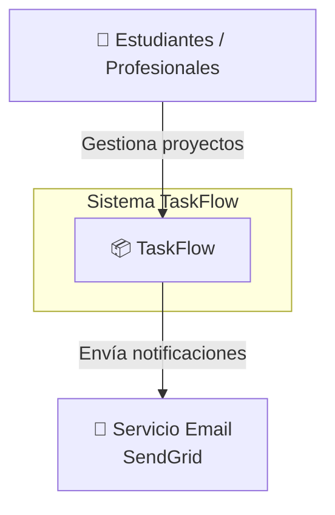
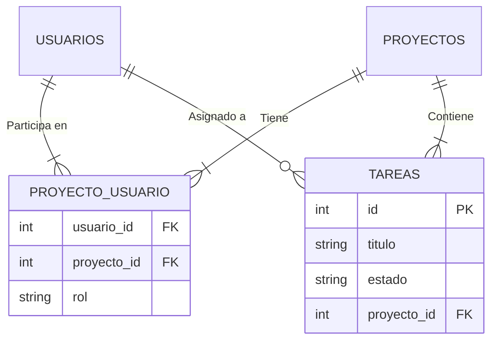

# Sesión 05 — Diseño de arquitectura y diagramas técnicos

## 2º CFGS DAW/DAM · Proyecto Intermodular II

---
---

## 🗺️ La sesión en un mapa

El arte de **diseñar y comunicar** la arquitectura de un sistema mediante diagramas: desde la visión de alto nivel hasta los detalles técnicos que servirán de **contrato entre equipos**.

<div class="features-grid" style="grid-template-columns:repeat(3,1fr);gap:0.7rem;">
  <div class="feature-item" style="padding:0.5rem 0.6rem;font-size:0.9rem;"><span class="feature-icon" style="font-size:1.4rem;margin-bottom:0.1rem;">🏗️</span><strong>Arquitectura</strong><br>Monolito vs. microservicios</div>
  <div class="feature-item" style="padding:0.5rem 0.6rem;font-size:0.9rem;"><span class="feature-icon" style="font-size:1.4rem;margin-bottom:0.1rem;">🔭</span><strong>Modelo C4</strong><br>Contexto y contenedores</div>
  <div class="feature-item" style="padding:0.5rem 0.6rem;font-size:0.9rem;"><span class="feature-icon" style="font-size:1.4rem;margin-bottom:0.1rem;">🗄️</span><strong>ERD</strong><br>Modelo de base de datos</div>
  <div class="feature-item" style="padding:0.5rem 0.6rem;font-size:0.9rem;"><span class="feature-icon" style="font-size:1.4rem;margin-bottom:0.1rem;">🎭</span><strong>Casos de uso</strong><br>El QUÉ del sistema</div>
  <div class="feature-item" style="padding:0.5rem 0.6rem;font-size:0.9rem;"><span class="feature-icon" style="font-size:1.4rem;margin-bottom:0.1rem;">⏱️</span><strong>Secuencia</strong><br>El CÓMO interactúan</div>
  <div class="feature-item" style="padding:0.5rem 0.6rem;font-size:0.9rem;"><span class="feature-icon" style="font-size:1.4rem;margin-bottom:0.1rem;">✍️</span><strong>DaC</strong><br>Mermaid y diagramas como código</div>
</div>

<div class="info">Ejemplo central: el ecosistema completo de <strong>TaskFlow</strong>, con perspectivas específicas para DAW, DAM y ASIR.</div>

---
class: compact-slide
---

## 🏛️ ¿Qué es la arquitectura de software?

> El conjunto de **decisiones estructurales fundamentales**: componentes, responsabilidades y cómo se comunican entre sí.

Es el **plano maestro** que permite que equipos distintos (DAW, DAM, ASIR) construyan piezas que encajan a la primera.

| La arquitectura… | Para qué |
| --- | --- |
| **Define la estructura** | Qué piezas existen y de qué son responsables |
| **Fija la comunicación** | APIs, mensajes, colas: los contratos entre equipos |
| **Guía el despliegue** | Dónde vive cada componente (nube, red, servidores) |
| **Documenta** | Punto de partida de todos los diagramas técnicos |

<div class="warning">Una decisión arquitectónica mal tomada se nota en cada sprint posterior: primero el plano, después el ladrillo.</div>

---
---

## 🔀 Estilos arquitectónicos: monolito vs. microservicios

<div class="comparison-grid">
  <div class="comparison-item"><strong>🧱 Monolito</strong><br><br>Todo el código en una sola aplicación, base de datos única, despliegue como unidad.<br><br><strong>+</strong> Simplicidad inicial, desarrollo rápido<br><strong>−</strong> Difícil de escalar, alto acoplamiento</div>
  <div class="comparison-item"><strong>🧩 Microservicios</strong><br><br>Servicios pequeños e independientes, cada uno con su base de datos, comunicación por APIs.<br><br><strong>+</strong> Escalabilidad, resiliencia, equipos autónomos<br><strong>−</strong> Complejidad operacional, latencia de red</div>
</div>

<div class="info">Encaja el estilo con el equipo y el calendario: TaskFlow empieza con una sola API para ganar velocidad sin cerrar la puerta a escalar.</div>

---
class: compact-slide
---

## 🌐 Nuestro enfoque: API-First (híbrido)

La API es la **fuente de verdad**: antes de escribir frontend o móvil, se define el contrato HTTP.

<div class="diagram-frame diagram-medium" style="height:280px;">
  <Excalidraw drawFilePath="/diagrams/ud05-pim-api-first.excalidraw" class="diagram-svg" :darkMode="false" :background="false" />
</div>

<div class="info">Un solo backend (Laravel), dos clientes (web y app) y una infraestructura que lo observa todo: quedaros con esta imagen, todos los diagramas derivan de ella.</div>

---
---

## 🏗️ Arquitectura API-First: vistas por equipo

La misma decisión estructural, tres lecturas distintas:

| Perfil | Su punto de vista | Su diagrama clave |
| --- | --- | --- |
| **DAW** | La API expone endpoints REST a todos los clientes | Contenedores + secuencia |
| **DAM** | La app móvil es un cliente más, con capacidad *offline* | Casos de uso + secuencia |
| **ASIR** | El sistema completo debe ser observable, escalable y resiliente | Despliegue + red |

<div class="step">
  <div class="step-number">1</div>
  <div class="step-content">Backend (DAW) expone la API REST como fuente de verdad, documentada y versionada.</div>
</div>
<div class="step">
  <div class="step-number">2</div>
  <div class="step-content">Web (DAW) y app móvil (DAM) consumen la <strong>misma API</strong>: no se duplica lógica.</div>
</div>
<div class="step">
  <div class="step-number">3</div>
  <div class="step-content">Infraestructura (ASIR) soporta, despliega y monitoriza el conjunto.</div>
</div>

<div class="warning">El contrato API se negocia <strong>antes</strong> de que los tres equipos empiecen a programar: después, cada cambio rompe el trabajo de los demás.</div>

---
---

## 📝 ¿Qué es un contrato API?

Un contrato API describe **qué peticiones acepta** la API y **qué responde**: rutas, métodos, parámetros y cuerpo de la respuesta.

<div class="code-card">
<span class="code-card-title">Ejemplo: crear una tarea en TaskFlow</span>

```http
POST /api/tareas HTTP/1.1
Authorization: Bearer <token>
Content-Type: application/json

{ "titulo": "Escribir informe", "proyecto_id": 3 }
```

```http
HTTP/1.1 201 Created
{ "id": 42, "titulo": "Escribir informe", "estado": "pendiente" }
```

</div>

<div class="info">Documentado con OpenAPI/Swagger, este contrato es la referencia de los tres equipos: DAW lo implementa, DAM y la web lo consumen, ASIR lo monitoriza.</div>

---
---

## 🔭 El Modelo C4: zoom progresivo

**C4 = Context, Containers, Components, Code**: abstracciones para visualizar la arquitectura en distintos niveles de zoom.

| Nivel | Qué muestra | Para quién |
| --- | --- | --- |
| **1. Contexto** | El sistema como caja negra y su entorno | Todo el mundo (dirección, cliente) |
| **2. Contenedores** | Los bloques técnicos: web, app, API, BD, colas | Los equipos técnicos |
| **3. Componentes** | Módulos internos de cada contenedor | El equipo que lo construye |
| **4. Código** | Clases y relaciones (a menudo, código fuente) | El desarrollador |

<div class="info">Hoy trabajamos los niveles 1 y 2, y el diagrama de despliegue: son los que piden los proyectos intermodulares. Como el zoom de un mapa: país → ciudad → calle.</div>

---
---

## 🔭 Nivel 1 — Diagrama de contexto

El sistema como **caja negra**: qué entra y qué sale, sin detalles internos.

<div class="diagram-frame diagram-medium" style="height:300px;">
  <Excalidraw drawFilePath="/diagrams/ud05-pim-contexto-c4.excalidraw" class="diagram-svg" :darkMode="false" :background="false" />
</div>

<div class="info">Cuatro o cinco líneas bastan: si un <em>stakeholder</em> no entiende tu contexto en 30 segundos, sobra detalle.</div>

---
class: compact-slide
---

## 📦 Nivel 2 — Diagrama de contenedores

Los **bloques técnicos principales** y las peticiones que fluyen entre ellos.

<div class="diagram-frame diagram-medium" style="height:320px;">
  <Excalidraw drawFilePath="/diagrams/ud05-pim-contenedores-c4.excalidraw" class="diagram-svg" :darkMode="false" :background="false" />
</div>

<div class="info">Cada contenedor señala quién lo trabaja: DAW desarrolla la web y la API; DAM la app móvil; ASIR gestiona Postgres, Redis y despliegue.</div>

---
---

## 🚀 Diagrama de despliegue

**Dónde vive** cada componente: servidores, nube, redes, subnets... Responsabilidad principal: **ASIR**, aunque los tres equipos deben entenderlo.

<div class="two-cols">
  <div class="left">
    <h3>El flujo (TaskFlow)</h3>
    <div class="step">
      <div class="step-number">1</div>
      <div class="step-content"><strong>git push</strong> a GitLab → pipeline CI/CD (tests + build).</div>
    </div>
    <div class="step">
      <div class="step-number">2</div>
      <div class="step-content">El <strong>Load Balancer</strong> reparte HTTPS:443: web en subnet pública, API en subnet privada.</div>
    </div>
    <div class="step">
      <div class="step-number">3</div>
      <div class="step-content">La API persiste en <strong>RDS PostgreSQL</strong> Multi-AZ y sube archivos a <strong>S3</strong>.</div>
    </div>
  </div>
  <div class="right">
    <h3>Lecturas por equipo</h3>
    <ul>
      <li><strong>DAW</strong>: dónde corre Laravel (EC2) y por dónde entra el tráfico.</li>
      <li><strong>DAM</strong>: distribución por tiendas + <em>Firebase Cloud Messaging</em> para push.</li>
      <li><strong>ASIR</strong>: subnets, security groups, Multi-AZ, monitorización con CloudWatch.</li>
    </ul>
  </div>
</div>

<div class="warning">No confundir contenedores (lógico) con despliegue (físico): un EC2 puede alojar varios contenedores; la subnet pública expone la web, la privada resguarda API y BD.</div>

---
class: compact-slide
---

## ⌨️ Diagrama de contexto en Mermaid

El mismo diagrama de contexto, escrito como texto: se versiona con Git.



<style>
html.md-mermaid { font-size: 16px; }
</style>

**Lectura por equipo (resumen):** DAW → la API expone endpoints REST · DAM → cliente más con capacidad *offline* · ASIR → observable, escalable y resiliente.

<div class="info">Lo importante no es el dibujo: es la <strong>idea</strong> que comunica.</div>


---
class: compact-slide
---

## 🗄️ Diagramas Entidad-Relación (ERD)

El **plano de la base de datos**: tablas, columnas, tipos y relaciones. Se diseña **antes** de escribir una línea de SQL. Responsabilidad principal: **DAW** (pero DAM y ASIR deben entenderlo).

**Componentes clave:**

| Componente | Descripción | Ejemplo |
| --- | --- | --- |
| **Entidades** | Conceptos del negocio | USUARIOS, PROYECTOS, TAREAS |
| **Atributos** | Propiedades de cada entidad | id, nombre, email, password_hash |
| **Relaciones** | Cardinalidad entre tablas | 1:1 perfil, 1:N proyecto→tareas, N:M usuarios↔proyectos (tabla pivote) |

<div class="two-cols">
  <div class="left">
    <h3>Reglas de oro</h3>
    <ul>
      <li>Toda tabla lleva <strong>id</strong> (PK) autoincremental; las ajenas, <code>&lt;entidad&gt;_id</code> (FK).</li>
      <li>Emails y valores únicos llevan <strong>UK</strong>; datos sensibles, siempre hasheados.</li>
    </ul>
  </div>
  <div class="right">
    <h3>Cómo se lee el N:M</h3>
    <ul>
      <li>Usuarios ↔ Proyectos = <strong>tabla pivote</strong>: <code>PROYECTO_USUARIO (usuario_id FK, proyecto_id FK, rol)</code>.</li>
      <li>El atributo <code>rol</code> vive en la relación, no en las entidades.</li>
    </ul>
  </div>
</div>

<div class="info">El N:M no existe en SQL: siempre se materializa con una tabla pivote. Si no la ves en el diagrama, falta.</div>

---
class: compact-slide
---

## 🗄️ ERD de TaskFlow (básico)



**Consultas que facilita el diseño:**

```sql
-- Tareas pendientes del usuario 7 con su proyecto
SELECT t.titulo, p.nombre, t.estado
FROM tareas t
JOIN proyectos p ON p.id = t.proyecto_id
WHERE t.usuario_asignado_id = 7 AND t.estado <> 'completada';
```

<div class="info">Un buen ERD responde preguntas de negocio con una sola consulta: si te cuesta escribir el SQL, el modelo está mal.</div>

---
class: compact-slide
---

## 🎭 Diagramas de casos de uso

Describen **QUÉ** hace el sistema desde la perspectiva de un actor. Propósito: documentar los requisitos funcionales de forma visual. Responsabilidad principal: **DAM** (móvil) y **DAW** (web).

<div class="two-cols">
  <div class="left">
    <h3>Componentes</h3>
    <ul>
      <li><strong>Actores</strong>: Usuario Registrado, Administrador, Sistema de Email.</li>
      <li><strong>Casos de uso</strong>: Iniciar Sesión, Crear Tarea, Ver Proyectos.</li>
      <li><strong>Herencia</strong>: un Administrador hereda todo lo del Usuario Registrado.</li>
    </ul>
  </div>
  <div class="right">
    <h3>Relaciones</h3>
    <ul>
      <li><strong>«include»</strong> (obligatoria): todas las acciones incluyen <em>Validar Autenticación</em>.</li>
      <li><strong>«extend»</strong> (opcional): <em>Crear tarea</em> puede extenderse con <em>Adjuntar archivo</em>.</li>
      <li><strong>Regla práctica</strong>: ¿siempre ocurre? «include». ¿Solo a veces? «extend».</li>
    </ul>
  </div>
</div>

<div class="info">Ejemplo TaskFlow web, en la siguiente diapositiva: «Crear Tarea» incluye «Validar Autenticación» (siempre), «Recuperar Contraseña» extiende a «Iniciar Sesión» (solo a veces) y el Administrador hereda del Usuario Registrado.</div>

---
class: compact-slide
---

## 🎭 Ejemplo: casos de uso de TaskFlow (web)

<div class="diagram-frame diagram-medium">
  <Excalidraw drawFilePath="/diagrams/sesion05-pim-casos-uso.excalidraw" class="diagram-svg" :darkMode="false" :background="false" />
</div>

<div class="info">Lectura: continuas = actor–caso de uso · «include» (<em>siempre</em>): <em>Crear Tarea</em> → <em>Validar Autenticación</em> · «extend» (<em>opcional</em>): <em>Recuperar Contraseña</em> → <em>Iniciar Sesión</em> · triángulo: el <em>Administrador</em> hereda del <em>Usuario</em> (y añade <em>Gestionar Usuarios</em>).</div>

---
---

## ⏱️ Diagramas de secuencia

Muestran **CÓMO** interactúan los componentes a lo largo del tiempo, en un flujo concreto. Todos los equipos diseñan sus flujos.

| Elemento | Significado | Notación |
| --- | --- | --- |
| **Participantes** | Componentes que interactúan | Líneas de vida verticales |
| **Mensaje síncrono** | El emisor espera respuesta | `->>` flecha sólida |
| **Mensaje asíncrono** | El emisor no espera respuesta | `-->>` flecha discontinua |
| **alt / opt** | Alternativa u opcional (if-else) | Bloque con etiqueta |
| **loop / par** | Bucle u operaciones paralelas | Bloque con etiqueta |

<div class="info">Regla de estilo: cada mensaje lleva nombre de operación y datos; si no cabe, el flujo es demasiado grande y hay que dividirlo.</div>

---
---

## ⏱️ Secuencia: registro de usuario

<div class="diagram-frame diagram-medium" style="height:300px;">
  <Excalidraw drawFilePath="/diagrams/ud05-pim-secuencia-registro.excalidraw" class="diagram-svg" :darkMode="false" :background="false" />
</div>

<div class="info">Fijaos en el fragmento «alt»: email duplicado → 409 · email nuevo → INSERT + 201. El correo de bienvenida va con flecha discontinua: asíncrono, la API no espera.</div>

---
---

## 🛠️ Herramientas visuales (WYSIWYG)

**Lo que ves es lo que tocas**: dibujas con el ratón y el diagrama queda tal cual.

<div class="two-cols">
  <div class="left">
    <h3>Draw.io (diagrams.net)</h3>
    <ul>
      <li>Gratuita y open source.</li>
      <li>Extensión en VS Code, integración con Google Drive y GitHub.</li>
      <li>Bibliotecas de iconos: AWS, Azure, UML, redes.</li>
      <li><strong>Ideal para</strong>: despliegue y red (ASIR), prototipos rápidos de arquitectura.</li>
    </ul>
  </div>
  <div class="right">
    <h3>Lucidchart</h3>
    <ul>
      <li>Interfaz profesional, colaboración en tiempo real.</li>
      <li>Comentarios, revisiones y plantillas.</li>
      <li><strong>Contras</strong>: plan gratuito muy limitado (3 diagramas).</li>
    </ul>
  </div>
</div>

<div class="info">Son la vía rápida para ilustraciones puntuales; su problema: el diagrama vive fuera de Git y es difícil de versionar y comparar.</div>

---
class: compact-slide
---

## ✍️ Diagramas como código (Mermaid / DaC)

En lugar de dibujar, **describes el diagrama escribiendo texto**; la herramienta lo genera. Vive en el repo, versionado con el código.

<div class="comparison-grid">
  <div class="comparison-item"><strong>✅ DaC: sí</strong><br><br>Se versiona en <strong>Git</strong>: cambia con el código, en el mismo commit.<br>Fuente única de verdad: nada de PNGs perdidos en Drive.<br><strong>Renderizado nativo</strong> en GitHub, GitLab, VS Code, Notion.</div>
  <div class="comparison-item"><strong>⚠️ DaC: cuidado</strong><br><br>Sintaxis que aprender (aunque es sencilla).<br>Layouts complejos (cloud, VLANs) mandan mejor en Draw.io.<br>Híbrido: Mermaid + herramienta visual = lo mejor de ambos.</div>
</div>

**Sintaxis básica (flowchart):**  `A[Inicio] --> B{¿Autenticado?} → Sí: Dashboard / No: Login`

<div class="info">Con <strong>flowchart</strong>, <strong>erDiagram</strong> y <strong>sequenceDiagram</strong> cubrís el 90&nbsp;% del proyecto.</div>

---
---

## 🧭 ¿Qué diagrama uso cada vez?

Guía rápida para elegir la herramienta correcta en cada situación del proyecto:

| Pregunta que quiero responder | Diagrama | Autor principal |
| --- | --- | --- |
| ¿Con quién se relaciona el sistema y qué le ofrecen terceros? | Contexto C4 | Los tres |
| ¿Qué bloques técnicos forman TaskFlow y quién los construye? | Contenedores C4 | DAW / DAM |
| ¿Dónde corre cada cosa (nube, redes, subnets)? | Despliegue | ASIR |
| ¿Cómo se organizan los datos? | ERD | DAW |
| ¿Qué puede hacer cada actor? | Casos de uso | DAW / DAM |
| ¿Qué mensajes se pasan y en qué orden? | Secuencia | Los tres |
| ¿Qué heredan los componentes de infraestructura? | Despliegue + red | ASIR |

<div class="info">Antes de dibujar, pregúntate a <strong>quién</strong> le va a servir: el público manda sobre la herramienta.</div>

---
class: compact-slide
---

## ✍️ DaC aplicado: de la idea al diagrama

**De idea a diagrama en tres pasos:**

<div class="step">
  <div class="step-number">1</div>
  <div class="step-content">Escribe el <strong>flujo en texto</strong> (participantes y mensajes): es el borrador más rápido.</div>
</div>
<div class="step">
  <div class="step-number">2</div>
  <div class="step-content">Tradúcelo a <strong>Mermaid</strong> y déjalo en <code>docs/diagramas.md</code>, versionado con el código.</div>
</div>
<div class="step">
  <div class="step-number">3</div>
  <div class="step-content">Si el layout se hace inmanejable, <strong>migra a Draw.io</strong> y deja en el .md un enlace.</div>
</div>

**Pseudocódigo del flujo de registro** (lo que alimentará el diagrama de secuencia):

```text
SI no existe email:
  hashear contraseña (bcrypt)
  INSERT usuario
  devolver 201 Created
  enviar email bienvenida (asíncrono)
SI NO:
  devolver 409 Conflict
```

<div class="info">Escribir el pseudocódigo antes del diagrama evita olvidar el camino de error: el 90&nbsp;% de los flujos reales son «todo va bien» … hasta que no.</div>

---
---

## ✅ Resumen de la sesión

- La **arquitectura de software** son las decisiones estructurales que permiten que tres equipos construyan piezas que encajan: en TaskFlow, estilo **API-First** con la API como fuente de verdad.
- El **modelo C4** da zoom progresivo: contexto (caja negra) → contenedores (bloques técnicos) → despliegue (dónde vive).
- El **ERD** es el plano de la BD; las N:M se materializan con tabla pivote.
- Los **casos de uso** documentan el *qué* (include/extend); la **secuencia**, el *cómo* (alt, síncrono/asíncrono).
- **DaC con Mermaid**: diagramas versionados junto al código; WYSIWYG (Draw.io, Lucidchart) para layouts complejos.
- Los **ejemplos** de cada diagrama (contexto, ERD, casos de uso, secuencia) sirven de plantilla para los del proyecto.

---
layout: closing
---
