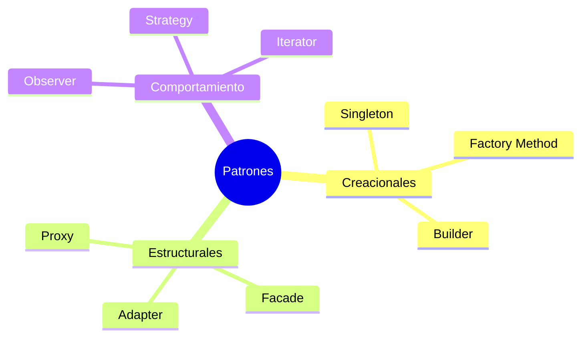
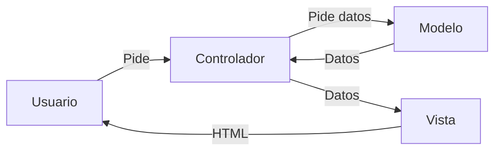
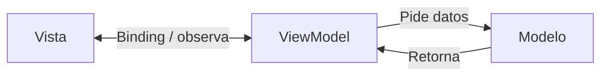
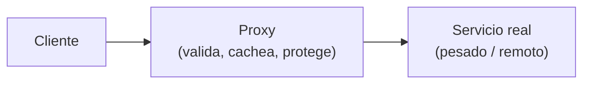
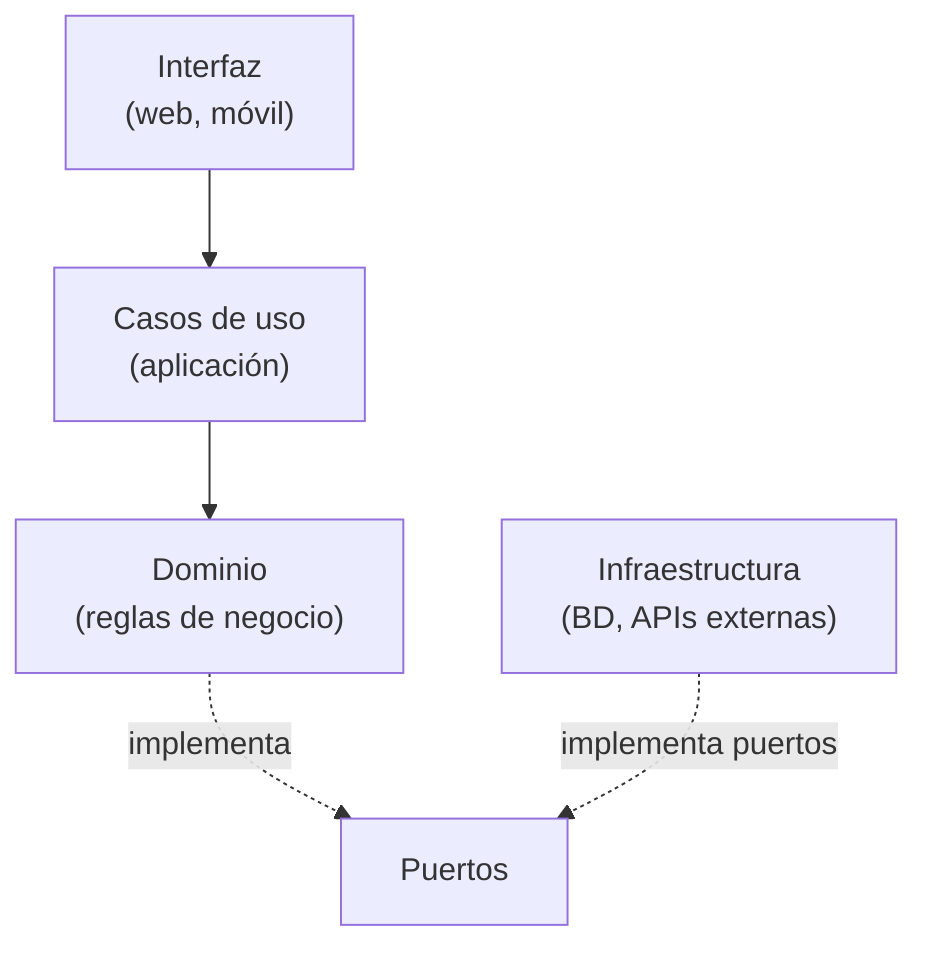
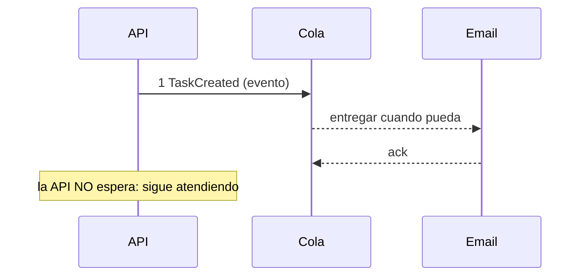

# Sesión 06 — Patrones de Diseño

## 2º CFGS DAW/DAM · Proyecto Intermodular II

---
---

## 🗺️ La sesión en un mapa

De crear objetos a organizar sistemas: **soluciones probadas y reutilizables** a los problemas comunes del diseño de software.

<div class="features-grid" style="grid-template-columns:repeat(3,1fr);gap:0.7rem;">
  <div class="feature-item" style="padding:0.5rem 0.6rem;font-size:0.9rem;"><span class="feature-icon" style="font-size:1.4rem;margin-bottom:0.1rem;">⚙️</span><strong>Creacionales</strong><br>Singleton · Factory · Builder</div>
  <div class="feature-item" style="padding:0.5rem 0.6rem;font-size:0.9rem;"><span class="feature-icon" style="font-size:1.4rem;margin-bottom:0.1rem;">🧩</span><strong>Estructurales</strong><br>Adapter · Facade · Proxy</div>
  <div class="feature-item" style="padding:0.5rem 0.6rem;font-size:0.9rem;"><span class="feature-icon" style="font-size:1.4rem;margin-bottom:0.1rem;">📡</span><strong>Comportamiento</strong><br>Observer · Strategy · Iterator</div>
  <div class="feature-item" style="padding:0.5rem 0.6rem;font-size:0.9rem;"><span class="feature-icon" style="font-size:1.4rem;margin-bottom:0.1rem;">🏛️</span><strong>MVC · MVVM</strong><br>Organizar la app</div>
  <div class="feature-item" style="padding:0.5rem 0.6rem;font-size:0.9rem;"><span class="feature-icon" style="font-size:1.4rem;margin-bottom:0.1rem;">♻️</span><strong>Arquitectura Limpia</strong><br>Hexagonal</div>
  <div class="feature-item" style="padding:0.5rem 0.6rem;font-size:0.9rem;"><span class="feature-icon" style="font-size:1.4rem;margin-bottom:0.1rem;">🚀</span><strong>Microservicios</strong><br>BFF · API · Eventos</div>
</div>

<div class="info">Todo se aplicará al proyecto <strong>TaskFlow</strong>: cada patrón resuelve un problema concreto que vais a tener este curso.</div>

---
class: compact-slide
---

## 🧠 ¿Qué es un patrón de diseño?

No es código para copiar y pegar (ni una función tipo `sort()`): es una **solución probada y reutilizable** a un problema común.

<div class="comparison-grid">
  <div class="comparison-item"><strong>🍳 Algoritmo = receta</strong><br><br>Pasos exactos y secuenciales: «1. Cortar cebolla · 2. Sofreir · 3. Añadir tomate».<br>Si te saltas un paso, <strong>fallas</strong>.</div>
  <div class="comparison-item"><strong>📐 Patrón = plano</strong><br><br>Te muestra el resultado y la disposición de las piezas.<br>Los materiales y el orden <strong>los decides tú</strong> en cada proyecto.</div>
</div>

<div class="info">Un patrón es una <strong>plantilla conceptual</strong>: una idea estructurada, no una pieza de código.</div>

---
---

## 💪 ¿Por qué usar patrones?

| Beneficio | Sin patrones | Con patrones |
| --- | --- | --- |
| **Lenguaje común** | «Necesito una clase con una única instancia que centralice la conexión a la BD…» | «Usa un <strong>Singleton</strong> para la conexión a la BD» |
| **Soluciones comprobadas** | Reinventar la rueda (y sus errores) | Décadas de uso en la industria, diseño sólido (SOLID) |
| **Mantenibilidad** | Código acoplado: cambia una pieza, se rompe otra | Desacopla el sistema: escala y se modifica sin romperse |

<div class="warning">Una mala arquitectura genera <strong>deuda técnica</strong> que colapsa el proyecto cuando crece: los patrones son una inversión en el futuro de vuestro código.</div>

---
---

## 🗂️ Las tres familias

| Familia | Propósito | Analogía clave |
| --- | --- | --- |
| **Creacionales** | Cómo se <strong>crean</strong> los objetos, sin usar `new` directamente | 🏭 La fábrica: delegar la producción |
| **Estructurales** | Cómo se <strong>ensamblan</strong> en estructuras mayores | 🔌 El adaptador: conectar lo incompatible |
| **Comportamiento** | Cómo <strong>colaboran</strong> y se reparten responsabilidades | 📻 La radio: emitir sin saber quién escucha |


---
class: compact-slide
---

## ⚙️ Creacionales (I): Singleton

**Problema:** ciertas cosas solo pueden existir **una vez** (conexión a la BD, configuración, logger). Si cada módulo crea la suya… caos.

> **Analogía 🏀:** en un videojuego de baloncesto solo hay **una pelota**. El patrón garantiza esa única instancia y un punto de acceso global a ella.

```java
public class BasedeDatos {
  private static BasedeDatos instancia;   // la única

  private BasedeDatos() { }               // constructor privado: nadie hace new()

  public static BasedeDatos getInstancia() {
    if (instancia == null) instancia = new BasedeDatos();
    return instancia;
  }
}
```

<div class="info">Uso razonable: configuración, caché, conexión central. <strong>Abuso</strong>: convierte al Singleton en un contenedor global de todo ( «God Object») difícil de testear.</div>

---
class: compact-slide
---

## ⚙️ Creacionales (II): Factory y Builder

<div class="comparison-grid">
  <div class="comparison-item"><strong>🏭 Factory Method</strong><br><br>Delegar <em>qué objeto</em> crear a una fábrica, según el contexto.<br><br><em>Ejemplo:</em> la fábrica decide si crea <code>Barco</code> o <code>Camion</code> según la ruta; el conductor no sabe detalles de fabricación.</div>
  <div class="comparison-item"><strong>🍔 Builder</strong><br><br>Construir objetos complejos <strong>paso a paso</strong> con opciones.<br><br><em>Ejemplo:</em> pedir una hamburguesa a medida: sin cebolla, doble queso, pan brioche. Cada opción, un paso del builder.</div>
</div>

<div class="info">Ambos combaten lo mismo: el <code>new</code> por todas partes («hard-coding») que obliga a reescribir el código cuando cambia una clase.</div>

---
---

## 🏛️ MVC: el clásico

**Separar la interfaz de la lógica**. Estándar en backend (Laravel, Spring, Django).

> **Analogía 🍽️ El restaurante:** la <strong>Vista</strong> es el cliente que mira la carta; el <strong>Controlador</strong> es el camarero que toma nota y coordina (no cocina); el <strong>Modelo</strong> es la cocina: ingredientes, datos y reglas.



<div class="step"><div class="step-number">1</div><div class="step-content">Router: recibe la URL y elige el controlador.</div></div>
<div class="step"><div class="step-number">2</div><div class="step-content">Controlador: pide datos al modelo.</div></div>
<div class="step"><div class="step-number">3</div><div class="step-content">Vista (plantilla Blade/Twig): recibe los datos y genera el HTML.</div></div>

---
class: compact-slide
---

## 🏛️ MVC en Laravel (DAW)

```php
<?php
namespace App\Http\Controllers;
use App\Models\User;            // el MODELO

class UserController extends Controller {
    // El CONTROLADOR recibe la petición
    public function show($id) {
        $user = User::find($id);            // habla con el modelo
        return view('user.profile',        // carga la VISTA
            ['user' => $user]);
    }
}
```

```html
<!-- resources/views/user/profile.blade.php (la VISTA) -->
<h1>Perfil de {{ $user->name }}</h1>
<p>Email: {{ $user->email }}</p>
```

<div class="info">El controlador <strong>no</strong> devuelve HTML: devuelve una vista que se renderiza. Cada cosa en su sitio.</div>

---
class: compact-slide
---

## 🏛️ MVVM: el moderno

**Model–View–ViewModel**, hecho para pantallas reactivas: móvil (Jetpack), React, Vue.

> **Analogía 🪞 El espejo:** el ViewModel «sonríe» y la vista se actualiza al instante. No hay que decirle «píntame la sonrisa»: la <strong>reactividad</strong> lo hace sola (data binding).



```kotlin
class ContadorViewModel : ViewModel() {
    val numero = MutableLiveData(0)
    fun incrementar() { numero.value = (numero.value ?: 0) + 1 }
}
// La Vista se SUSCRIBE: cada cambio de 'numero' repinta la UI
viewModel.numero.observe(this) { texto.text = "Valor: $it" }
```

<div class="info">La vista <strong>no conoce al modelo</strong>: solo al ViewModel. En React/Vue, el <code>state</code> del componente cumple ese mismo papel (<code>UI = f(State)</code>).</div>

---
---

## 🛡️ Estructurales: Adapter y Facade

**Problema:** clases incompatibles, o añadir funcionalidad sin tocar el código fuente.

<div class="comparison-grid">
  <div class="comparison-item"><strong>🔌 Adapter</strong><br><br><em>El adaptador de viaje:</em> envuelve tu enchufe para que encaje en la pared. Ni la pared ni el portátil cambian, pero <strong>ahora cooperan</strong>.<br><br><em>Caso real:</em> una API antigua que devuelve <strong>XML</strong> funcionando en tu app moderna que espera <strong>JSON</strong>.</div>
  <div class="comparison-item"><strong>🏨 Facade</strong><br><br><em>La recepción del hotel:</em> una interfaz simple para manejar sistemas complejos internos (limpieza, cocina, reservas) que <strong>no ves</strong>.<br><br><em>Caso real:</em> <code>CamaraFacil().tomarFoto()</code> que por dentro gestiona permisos, sensores y buffers.</div>
</div>

---
class: compact-slide
---

## 🛡️ Estructural: Proxy

Un **intermediario que controla el acceso** al objeto real, añadiendo lógica sin tocarlo.

> **Analogía 💳 La tarjeta de crédito:** representa el dinero real (que está en el banco) y añade <strong>control, validación y seguridad</strong> antes de completar la transacción.



<div class="step"><div class="step-number">1</div><div class="step-content">El cliente llama al proxy igual que llamaría al objeto real (misma interfaz).</div></div>
<div class="step"><div class="step-number">2</div><div class="step-content">El proxy decide: valida permisos, devuelve caché o reenvía al real.</div></div>
<div class="step"><div class="step-number">3</div><div class="step-content">El objeto real queda protegido: nadie lo usa sin pasar por el proxy.</div></div>

---
class: compact-slide
---

## ♻️ Arquitectura Limpia (Hexagonal)

**El dominio en el centro**: la lógica de negocio no depende de la BD, del framework ni del UI.

<div class="two-cols">
  <div class="left">



  </div>
  <div class="right">

| Ventaja | Consecuencia |
| --- | --- |
| El núcleo es **testeable** sin BD ni HTTP | Tests rápidos y estables |
| Cambiar de BD o de UI solo toca la capa exterior | Menos riesgo al evolucionar |
| Los «puertos» son los contratos | Adapters intercambiables |

  </div>
</div>

<div class="warning">La idea clave: <strong>las dependencias apuntan hacia el dominio</strong>. Si tu clase de negocio importa una librería de base de datos, la arquitectura está invertida.</div>

---
---

## 🚀 Microservicios y BFF

De un solo bloque a **servicios pequeños e independientes**, cada uno con su BD.

<div class="comparison-grid">
  <div class="comparison-item"><strong>🧱 Monolito</strong><br><br>Todo en una app y una BD.<br><strong>+</strong> Simple de desarrollar y desplegar<br><strong>−</strong> Escalar = escalar todo; acoplamiento</div>
  <div class="comparison-item"><strong>📱 BFF <em>(Backend For Frontend)</em></strong><br><br>Una capa intermedia por cliente: el BFF de móvil devuelve datos ya recortados para la pantalla del móvil; el BFF de web, para la web.<br><strong>+</strong> Cada cliente recibe lo que necesita<br><strong>−</strong> Más piezas que mantener</div>
</div>

<div class="info">En TaskFlow: una API principal (DAW) y, si el móvil (DAM) necesita datos muy distintos, un BFF móvil delante. No empieces por microservicios: <strong>gana primero un monolito modular</strong>.</div>

---
class: compact-slide
---

## 📡 ¿Cómo hablan los servicios?

| | Síncrono ☎️ (llamada) | Asíncrono ✉️ (email) |
| --- | --- | --- |
| **Modelo** | «Te pregunto y <strong>me quedo esperando</strong>» | «Te dejo el mensaje en el buzón, lo lees cuando puedas» |
| **Tecnologías** | REST, GraphQL, gRPC | Colas de mensajes: RabbitMQ, Kafka |
| **Riesgo / baza** | Si el receptor está caído, **tú también fallas** | Si el receptor está caído, el mensaje **espera en la cola**: resiliencia |



<div class="info">Comunicación por <strong>eventos</strong> («TaskCreated») desacopla productores y consumidores: el emisor no sabe quién escucha, como una <strong>radio</strong> 📻. El correo de bienvenida de TaskFlow debe ir asíncrono.</div>

---
class: compact-slide
---

## 📦 Patrones de acompañamiento: Sidecar y Ambassador

Cuando el patrón vive **fuera del proceso**, a su lado (*sidecar*) o delante (*ambassador*). Muy usados en contenedores y Kubernetes.

<div class="comparison-grid">
  <div class="comparison-item"><strong>🛵 Sidecar</strong><br><br>Un proceso <strong>a tu lado</strong>, mismo ciclo de vida: ej. un contenedor de logs al lado de la app en el mismo Pod.<br><br><em>Gana:</em> la app no sabría exportar logs; el sidecar los colecta.</div>
  <div class="comparison-item"><strong> 🚀 Ambassador</strong><br><br>Un <strong>delegado en la red</strong>: la app llama a «localhost», el ambassador hace retry, TLS o descubrimiento de servicios.<br><br><em>Gana:</em> la lógica de red vive fuera del código de la app.</div>
</div>

<div class="info">Ambos aplican la misma idea hexagonal: <strong>separar la lógica de negocio de la infraestructura</strong> sin tocar el código de la aplicación.</div>

---
class: compact-slide
---

## 🛡️ Resiliencia y seguridad (patrones de la gran ciudad)

| Patrón | Qué hace | Analogía ciudad |
| --- | --- | --- |
| **Circuit Breaker** | Si el servicio falla mucho, «abre el circuito» y no lo llama un tiempo | 🔌 Un fusible: corta la corriente |
| **Retry + Backoff** | Reintentar con esperas crecientes: 1s, 2s, 4s… | 🚦 Volver a intentarlo cuando la cola baja |
| **Rate Limiting** | Limitar cuántas peticiones acepta un servicio | 🎫 Entradas agotadas: no entra más gente |
| **API Gateway** | Un único punto de entrada: autentica, limita y enruta | 🛂 El control del aeropuerto |

<div class="warning">En TaskFlow: el <strong>API Gateway</strong> delante de los servicios y un <strong>circuit breaker</strong> llamando al servicio de email externo: si SendGrid cae, TaskFlow no debe caer con él.</div>

---
---

## 🧩 Aplicación al proyecto: TaskFlow con patrones

| Necesidad del proyecto | Patrón que la resuelve |
| --- | --- |
| Una única conexión a la BD y configuración global | <strong>Singleton</strong> |
| Crear notificaciones push/email según el canal | <strong>Factory Method</strong> |
| Adaptar la API antigua XML al cliente nuevo JSON | <strong>Adapter</strong> |
| Simplificar el subsistema de BD en un método `guardarTarea()` | <strong>Facade</strong> |
| Caché y control de acceso delante de la API | <strong>Proxy</strong> |
| Notificar a los clientes cuando cambia una tarea | <strong>Observer / eventos</strong> (asíncrono) |

<div class="info">No os vale «conozco 30 patrones»: en la memoria, <strong>justificad 3-4 patrones concretos</strong> que hayáis aplicado, con el problema y la solución.</div>

---
class: compact-slide
---

## ✅ Resumen de la sesión

- Un patrón es una **solución probada y reutilizable**: un plano, no un código para copiar.
- **Creacionales** (Singleton, Factory, Builder) controlan los `new`.
- **Estructurales** (Adapter, Facade, Proxy) conectan y protegen piezas.
- **MVC/MVVM y Arquitectura Hexagonal** organizan la app: cada cosa en su sitio, dependencias hacia el dominio.
- **Microservicios, eventos y patrones de resiliencia** preparan el sistema para crecer sin caerse.
- En la memoria del proyecto: **3-4 patrones aplicados, con problema y justificación**.

<div class="info">Todos los patrones comparten una obsesión: <strong>reducir el acoplamiento</strong> — que un cambio en una pieza no rompa las demás.</div>

---
layout: closing
---
