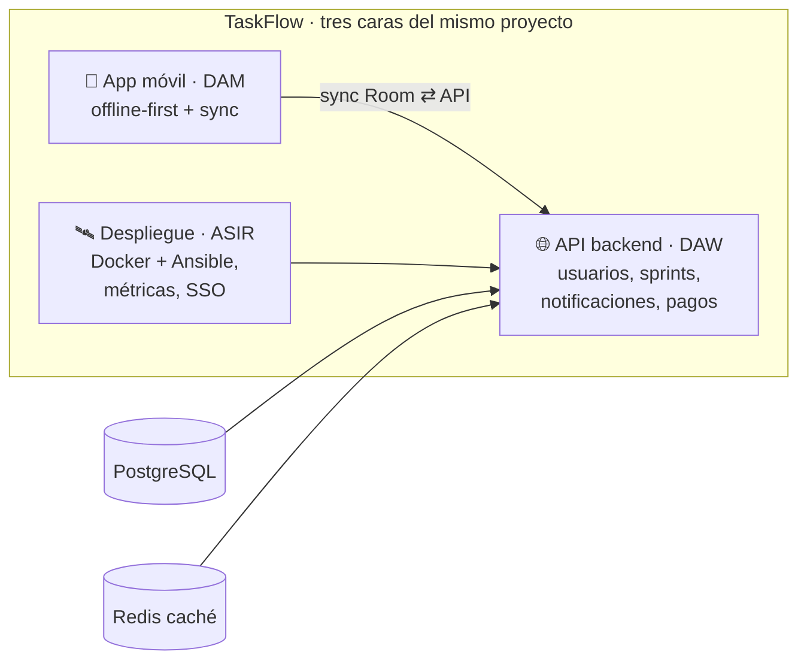
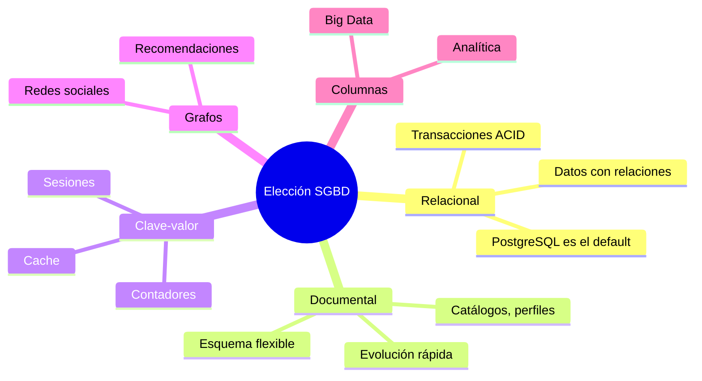
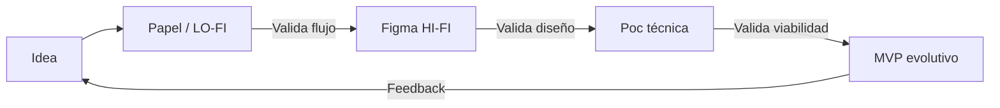
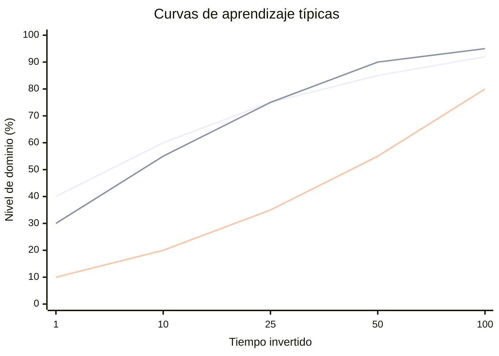

# Sesión 7 — Elección de Herramientas: SGBD, Licencias, Prototipado y Curvas de Aprendizaje

## 1. ¿Por qué es tan importante elegir bien?

Elegir las herramientas de un proyecto (el SGBD, el framework, la licencia, incluso el idioma de programación) es una de las decisiones más costosas de revertir. Si te equivocas en un algoritmo, arreglas la función. Si te equivocas en el SGBD, o en la licencia de un componente crítico, el coste de cambio puede obligar a reescribir el proyecto entero.

> [!TIP] Analogía: Construir una casa
> Elegir el SGBD es como decidir si tu casa tendrá **mantenimiento eléctrico** o **de gas**: si lo decides mal, no es solo cambiar un enchufe, es **levantar las paredes** para pasar tuberías nuevas. Una decisión de arquitectura (y de herramientas) no es un detalle: es el sistema circulatorio del proyecto.

Existen cuatro ejes de decisión (con sus analogías) en esta sesión:

| Eje de decisión | Pregunta clave | Riesgo si te equivocas |
| :--- | :--- | :--- |
| **SGBD** | ¿Cómo organizo y consulto mis datos? | Modelos imposibles, rendimiento pésimo |
| **Licencias** | ¿Qué puedo (legalmente) hacer con esta herramienta? | Demanda, proyecto «venenoso» a juicio |
| **Prototipado** | ¿Cómo valido la idea antes de construirla? | Construyes 3 meses lo que nadie quería |
| **Curva de aprendizaje** | ¿Cuánto voy a tardar en ser productivo? | Sprint retrasado, equipo frustrado |

Los cuatro ejes se estudian en las secciones 2-5 y las secciones 6-8 los aterrizan en los **casos típicos de PI por ciclo** (DAM, DAW y ASIR); las secciones 9-10 amplían la mirada a las **herramientas con las que se trabaja** (el entorno de desarrollo y los agentes de IA de programación); la matriz (11) y el checklist (12) recogen la decisión. Combiné ambos caminos en una única sesión porque en la práctica una decisión de herramienta casi siempre toca más de un eje: elegir MongoDB te arrastra a revisar una licencia (SSPL) y tu curva de aprendizaje con agregaciones.

Y todo se amarre a un ejemplo que ya conoces de la web: **TaskFlow**, el sistema de gestión de tareas colaborativo (tipo Trello/Jira) del Proyecto Final. Encaja perfecto porque toca los tres ciclos a la vez — app móvil offline (DAM), API con usuarios, notificaciones y pagos (DAW), despliegue con métricas y SSO (ASIR) — así que cada eje de decisión de las secciones 2-5 se comprueba una y otra vez contra él:



---

## 2. Tipos de SGBD (Sistemas de Gestión de Bases de Datos)

### 2.1 El ecosistema: Relacional vs. NoSQL

No hay «mejor» SGBD: hay **el adecuado para tu modelo de datos**.

> [!TIP] Analogía: El Taller vs. El Almacén
> Un SGBD **relacional** es un **taller de precisión**: cada pieza (fila) tiene su sitio exacto (esquema), las relaciones están atornilladas (FK) y las herramientas de calidad (transacciones ACID) son estrictas. Un SGBD **documental/NoSQL** es un **almacén logístico**: guardas palés (documentos JSON) de cualquier forma, es rapidísimo para «meter y sacar», pero no importa cómo *están* conectadas las cajas, sino a qué velocidad fluyen.

| Grupo | Modelo de datos | Fortaleza | Debilidad | Ejemplos |
| :--- | :--- | :--- | :--- | :--- |
| **Relacional (SQL)** | Tablas y filas, esquema `fijo` | Integridad ACID, `JOIN`s complejos, 50 años de madurez | Escalado horizontal complejo, esquema rígido | PostgreSQL, MySQL, SQLite |
| **Documental** | Colecciones de documentos JSON | Flexibilidad de esquema, agnóstico a evolución | Sin `JOIN`s nativos, consistencia eventual | MongoDB, Firestore |
| **Clave-valor** | Diccionario gigante en memoria | Latencia microsegundos, caché y sesiones | Persistencia limitada, sin relaciones | Redis, Memcached |
| **Grafos** | Nodos y aristas (relaciones) | Consultas de conexiones profundas | Ecosistemas más pequeños, curva de aprendizaje steep (expressiones tipo Cypher) | Neo4j, Memgraph |
| **Columnas / Analíticas** | Columnas comprimidas, escaneo masivo | Agregaciones sobre millones de filas | No apto para OLTP (transaccionales) | Cassandra, ClickHouse |


> [!TIP] Ejemplos de la industria
> Cada SGBD domina un terreno: **banca y pagos** → relacional (PostgreSQL, Oracle); **chat y estado «en línea»** de WhatsApp → clave-valor (Redis) delante del almacenamiento de mensajes; **recomendador o red social** → grafo (Neo4j); **analítica sobre millones de eventos** → columnar (ClickHouse); **catálogo que muta a diario** → documental (MongoDB).

### 2.2 La regla práctica: TaskFlow

Para un proyecto intermodular (una app de gestión con usuarios, proyectos y tareas), la respuesta casi siempre es:

*   **PostgreSQL (relacional)** como SGBD principal. Es open source, soporta ACID y `JSONB` (semi-documental), y hay experiencia en el aula.
*   **Redis (clave-valor)** como caché si el rendimiento es un requisito (sesiones, tokens, listas de «pendientes»).
*   **MongoDB o un grafo** solo si tu dominio se define por documentos *sin relaciones predecibles* o por *conexiones profundas* (redes sociales, recomendadores).

::: details Ver SQL vs NoSQL: el mismo catálogo de productos

```sql
-- PostgreSQL: el catálogo es una tabla, las categorías OTRA tabla
CREATE TABLE categorias (
  id   SERIAL PRIMARY KEY,
  nombre VARCHAR(60) NOT NULL
);
CREATE TABLE productos (
  id            SERIAL PRIMARY KEY,
  nombre        VARCHAR(120) NOT NULL,
  precio        NUMERIC(10,2) NOT NULL,
  categoria_id  INT REFERENCES categorias(id)  -- FK: integridad
);
-- Consulta: ¿cuántos productos de cada categoría hay?
SELECT c.nombre, COUNT(p.id)
FROM productos p JOIN categorias c ON c.id = p.categoria_id
GROUP BY c.nombre;
```

```javascript
// MongoDB: el catálogo es una colección de documentos flexibles
// db.productos.insertOne({
//   nombre: "Teclado mecánico",
//   precio: 89.99,
//   categoria: { nombre: "Periféricos" },  // incrustado (denormalizado)
//   etiquetas: ["rgb", "switch-rojo"]      // sin esquema: cada doc es una isla
// })
// Consulta equivalente: cuenta por categoría
// db.productos.aggregate([
//   { $group: { _id: "$categoria.nombre", total: { $sum: 1 } } }
// ])
```

**Diferencia clave:** en SQL, cambiar una categoría es un `UPDATE` en una tabla (y afecta a todos los productos). En Mongo, si la categoría está incrustada, hay que actualizar **cada documento** uno a uno (o usar `$lookup`, que es menos cómodo que un `JOIN`).

:::

### 2.3 ¿Y si no sé elegir?

**Empieza en relacional (PostgreSQL).** El 90&nbsp;% de los proyectos empiezan y acaban bien con él. Ayúdate de una regla de tres:

1.  ¿Tienes **entidades con relaciones estables** (usuarios ↔ tareas)? → Relacional.
2.  ¿Tienes un **cuello de botella de lectura** (1000 req/s en la portada)? → Añade una **capa de caché** (Redis) delante, no cambies de SGBD.
3.  ¿Tu problema es **nativo de grafos** (¿"amigos de amigos que saben X"?), de **documentos desacoplados** o de **series temporales**? Entonces sí, evalúa NoSQL específico.

---

## 3. Tipos de Licencias

Tu proyecto es *tuyo*, pero probablemente use bibliotecas de terceros. Saber qué licencia tiene cada dependencia es una obligación profesional (y legal).

| Familia | Filosofía | Riesgo para tu proyecto | Ejemplos |
| :--- | :--- | :--- | :--- |
| **Permisiva** | «Haz lo que quieras, pero cita al autor» | Casi nulo | MIT, Apache 2.0, BSD-3 |
| **Copyleft débil (LGPL)** | El código de la librería debe seguir libre, pero **enlazado dinámicamente** no contamina tu app | Bajo / Medio | LGPL 2.1, LGPL 3.0 |
| **Copyleft fuerte (GPL)** | Si distribuyes un binario que incluye licencia GPL, **todo tu proyecto debe ser GPL** (efecto «viral») | Alto en productos cerrados | GPL 3.0, GPL 2.0 |
| **Copyleft de red (AGPL)** | GPL + «si los usuarios usan tu app por **red**», también aplica la GPL: mata el truco de «la distribuyo como SaaS, no como binario» | Muy alto en SaaS | AGPL 3.0 |
| **SaaS / Propietaria** | No compras el código: pagas por el *uso* (o los *datos*) | Encierro (*vendor lock-in*), costes variables | Licencias comerciales, APIs de pago |

::: details Ver el «tóxico» más común: GPL y tu API de pago

Imagina que usas una librería de hashing con licencia **GPL 3.0** y tu producto final es una **aplicación Android propietaria** que cobras por *freemium*:

1.  GPL exige que **quien recibe el binario** (el APK), reciba también el **código fuente** de todo (tu app incluida) bajo GPL.
2.  Si eso no te interesa, no puedes distribuirla: **el GPL «contamina» el producto final**.
3.  Alternativa: buscar una librería con licencia **MIT** o **Apache 2.0** (que no exigen revelar tu código), o encapsular la GPL en un **servicio separado** (que se comunica por HTTP) si la licencia lo permite expresamente.

Por eso, **la primera pregunta antes de añadir una dependencia es: ¿qué licencia tiene?** (Y la segunda: ¿es compatible con la forma en que distribuiré mi proyecto?)

:::

#### El desafío: licencias en el mundo real

*   **MIT / Apache 2.0**: el pan de cada día de JavaScript (React, Vue, Tailwind integralmente MIT). Úsalo sin miedo.
*   **GPL 3.0**: mueve tu lógica a un proyecto de software de infraestructura (como Nextcloud o WordPress) — muy común en el software «del servidor».
*   **AGPL 3.0**: el estándar de facto del software de infraestructura moderno (MinIO, Grafana, Dart...). Si montas un SaaS sobre él, tu SaaS debe ser AGPL.
*   **Sin licencia (`Unlicensed`)**: **el código no es libre**: por defecto, todos los derechos reservados. No lo uses. Nunca.
*   **Generar PDFs/facturas (el caso más típico en PI de DAW y DAM)**: iText es **AGPL-3.0** (o una licencia comercial cara), OpenPDF es **LGPL/MPL**, y dompdf **LGPL-2.1**; una mala elección aquí obliga a liberar el proyecto entero para imprimir una factura de 50 KB. Es el clásico ejemplo de licencia «trampa» en bibliotecas auxiliares.

> [!WARNING] La trampa clásica del copyleft
> No es «la licencia es mala», es «la licencia es incompatible con mi modelo de negocio». Un ángel (una lib GPL) te salva el trabajo de 20 horas, y en el trámite te convierte el proyecto entero en GPL. Revisa licencias **antes** de añadir la dependencia, y documentarlo en la memoria (tabla de dependencias y sus licencias) es un plus de profesionalidad.

::: details ¿Qué licencias tiene el stack de TaskFlow?

| Componente | Licencia | Consecuencia |
| :--- | :--- | :--- |
| **Compose, Retrofit, Room** (app Android) | Apache-2.0 | Sin drama |
| **SQLite** (copia local del móvil) | Dominio público | Sin drama |
| **Laravel / FastAPI** (API) | MIT | Sin drama |
| **PostgreSQL** (SGBD del núcleo) | PostgreSQL License (permisiva, tipo BSD) | Sin drama |
| **Redis** (caché) | BSD hasta v7.4; ≥7.4 es RSALv2/SSPL/AGPL | Solo vigila si **modificas** el servidor |
| **Firebase / Play Billing** (opcionales) | **SDK comerciales** | No es libre vs. no-libre: son términos de uso |

Moraleja: un stack entero puede ser Apache/MIT y aun así arrastra un SDK comercial — la columna clave no es la licencia de lo obvio, es la de lo accesorio.

:::

---

## 4. Prototipado

Un **prototipo** es una versión *rápida y barata* de una idea, construida únicamente para **aprender algo** antes de invertir tiempo en la implementación real.

> [!TIP] Analogía: El Maqueta del Arquitecto
> Un arquitecto no te muestra el edificio al precio final: te muestra una **maqueta de cartón** y un render. Sirve para «¿la cocina así o al revés?» y para cambiarlo **antes** de hormigonar. Un prototipo es lo mismo para software: validar estructura (navegación, flujos) sin «hormigonar» código de producción.

### 4.1 El espectro del prototipado

| Prototipo | Qué es | Herramienta típica | ¿Cuándo parar? |
| :--- | :--- | :--- | :--- |
| **LO-FI (papel / wireframe)** | Bocetos a mano o en blanco | Papel, Excalidraw, Balsamiq | Cuando el *flujo* está claro |
| **HI-FI (interactivo)** | Maqueta clicable, casi idéntica al producto | Figma, Adobe XD | Cuando el *diseño* convence al usuario |
| **Prueba de concepto (PoC)** | Código mínimo que demuestra que algo es **técnicamente posible** | Proyecto aparte, no integrado | Cuando se supera el «¿podemos?» |
| **MVP (Producto Mínimo Viable)** | Producto *real* y desplegado, con sus riesgos integrados | El stack real del proyecto | Cuando hay usuarios usándolo |

Todas las filas comparten una misión: **convertir una suposición en un aprendizaje medible** con el mínimo coste posible.

### 4.2 Desechable vs. Evolutivo

Esta es la distinción más importante de cara a tu proyecto:

*   **Prototipo desechable (*throwaway*):** tiene un objetivo: aprender, y luego **tirarlo**. El código es «sucio» a propósito (es lo que lo hace rápido). **Error clásico:** disfrazar el prototipo de producto final y entregar esa base a producción.
*   **Prototipo evolutivo:** se construye con el **stack real** y con calidad, porque su destino es **crecer hasta convertirse en el producto**. Es más lento de arrancar, pero no se tira nada.

**Regla práctica para PIM2:** el prototipo de interfaz (Figma) es **desechable**. El <abbr>MVP</abbr> que construyas después es la versión **evolutiva** de ese diseño, ahora sí, con tests y arquitectura.



> [!TIP] Ejemplo por ciclo
> El prototipo de un PI de **DAW** es el Figma HI-FI clicado; el de **DAM** es la maqueta de pantallas del móvil (mismo Figma, canvas de móvil); y el de **ASIR** es el **lab en VMs con snapshot** (desechable: se destruye sin piedad tras aprender). Lo que se conserva no es el prototipo, sino la **decisión** que validó.

> [!TIP] TaskFlow, fase a fase
> 1. **LO-FI**: el tablero de tareas en papel (una tarde).
> 2. **HI-FI**: Figma clicable del kanban con *drag & drop* (2-3 días).
> 3. **PoC técnica**: no es de pantallas, es de **riesgo técnico**: ¿sincroniza Room ⇄ API sin perder datos? (colas de envío, idempotencia, resolución de conflictos de edición).
> 4. **MVP evolutivo**: Compose + Room + Laravel/FastAPI + PostgreSQL, con tests.
>
> La maqueta se tira; la **decisión de sincronización** que validó la PoC se documenta en la memoria.

---

## 5. Curvas de Aprendizaje

La **curva de aprendizaje** modela cómo evoluciona tu conocimiento (eje Y) con el tiempo invertido (eje X). No todas las tecnologías tienen la misma forma de curva, y esa forma **importa** cuando decides con un calendario fijo.



### 5.1 Los tres perfiles

*   **Curva suave** (productivo enseguida, techo más bajo): ej. **JavaScript básico o Python**. Se llega a ser «útil» el primer día, pero llegar a ser «experto» requiere años (la parte fina del último 10&nbsp; %).
*   **Curva «de pared»** (difícil al principio, payoff enorme después): ej. **Rust, Haskell, Kubernetes, arquitectura limpia**. Al principio, cada hora es frustrante, pero **una vez superada la pared**,productividad a largo plazo es muy alta.
*   **Curva «S» (estándar)**: al principio cuesta, luego mejoras rápido (zona de «muerte del valle»), y al final llega a la meseta de dominio. Es la forma real de aprender casi todo.

### 5.2 Cómo influyen en la elección de herramientas

| Curva | Cuándo elegirla | Cuándo evitarla |
| :--- | :--- | :--- |
| **Suave (JS, Python, PHP)** | Plazos cortos, prototipos, equipos junior, proyectos intermodulares | Sistemas de altísima concurrencia, sistema operativo |
| **Pared (Rust, K8s, arquitecturas complejas)** | Proyectos de larga vida, requisitos de rendimiento/léxico extremos | Plazos de 3 meses (como PIM2), equipo sin experiencia previa |
| **S (Framework completo, e.g. Laravel o Spring)** | Proyectos de 4-6 meses con tutoría y comunidad activa | «Tengo 2 semanas»: no da tiempo a superar el valle |

> [!TIP] Analogía: El Camión vs. La Bicicleta
> Aprender un framework completo es como aprender a **conducir un camión**: inicialmente es pesado, con herramientas (ORM, rutas, migraciones) que no entiendes, pero cuando lo dominas, transportas lo que sea con eficacia. Aprender un *framework micro* (Express, Flask) es como **uma bicicleta**: en 10 minutos ya te mueves, pero cuando el proyecto crece, empezarán a pedirte «camión» (estructuras que el micro no impone) y tendrás que improvisarlas tú mismo, mal.

**Aplicación directa a PIM2:** elegiría el stack que el equipo ya ha tocado (o el que las sesiones previas del módulo fomentan), **aunque no sea el «más moderno»**: la curva de aprendizaje **no la paga el proyecto, la paga tu calendario**.

Si lo cruzamos con TaskFlow: Compose es media, Room es suave y Laravel/FastAPI entran por «S» (4-6 meses con tutoría). Y atención al detalle: el requisito clave de TaskFlow — **sincronizar el dispositivo offline con la API** — es un «camión» disfrazado de bicicleta: Express/Flask no te traen nada para idempotencia, colas ni resolución de conflictos, y tendrías que improvisar ese camión tú mismo, dentro del MVP, en dos meses.

---

## 6. Casos reales: PI de DAM (app nativa)

En Desarrollo de Aplicaciones Multiplataforma el PI típico es una **app móvil** (Android con Kotlin/Java, a veces de escritorio) que resuelve un problema concreto y delimitado: gestionar un inventario, registrar turnos, apuntar horas.

| Caso típico | Problema de fondo | SGBD recomendado | Curva dominante |
| :--- | :--- | :--- | :--- |
| **Inventario de pequeño comercio** | Stock, mínimos y avisos | **SQLite embebido** (offline-first) | Suave |
| **App de citas/turnos** (clínica, taller, peluquería) | Reservas, servicios, horarios | **PostgreSQL** (servidor) + SQLite local (caché) | Media |
| **Gestor de la FCT** (horas, tareas, firma del tutor) | Usuarios, estados, informes agregados | **PostgreSQL** | Media |

**El patrón común:** la app movil es **offline-first** (una SQLite local con Room) y, si hay servidor, es una **API REST ligera** con PostgreSQL detrás. No hay «una BD para todo»: la parte móvil lleva su copia y la parte servidor es la fuente de verdad.

> [!TIP] Analogía: la app movil es como un cuaderno
> El móvil es un **cuaderno** que el alumno lleva siempre encima (SQLite local: funciona sin red) y el servidor es la **biblioteca central** (PostgreSQL) a la que sincronizas al acabar la clase. Copiar notas dos veces es un poco incómodo (denormalización), pero nunca perder el trabajo por falta de cobertura vale el precio.

**Decisiones asociadas al PI de DAM:**

*   **Licencias**: el framework Android es **Apache-2.0** y Compose/Jetpack **MIT**; Retrofit (**Apache-2.0**) para la API: sin problema. Cuidado con los SDK **propietarios de uso** (Firebase, Play Billing, Google Maps, SDK de pagos): no es libre vs. no-libre, son **términos comerciales** que limitan cómo y dónde te valen.
*   **Prototipado**: maqueta de pantallas del móvil en Figma (**desechable**); si hay backend, la PoC de notificaciones o de cámara se hace aparte; el <abbr>MVP</abbr> con Compose + Room es **evolutivo**.
*   **Curvas**: Compose es media; Room, suave; si el PI incluye servidor, Laravel/FastAPI vuelven a caer en media.

> [!TIP] TaskFlow visto desde DAM
> La app de TaskFlow es el caso «citas/turnos» con extra de dificultad: **offline-first** (Room como copia local), sync en segundo plano (WorkManager) y notificaciones push. Las decisiones salen idénticas: Compose + Room, PoC de sincronización aparte y revisada la letra pequeña si toca un SDK comercial como Firebase.

---

## 7. Casos reales: PI de DAW (plataforma web)

En DAW el PI típico es una **plataforma web con roles**: algo que se consulta y se gestiona desde el navegador, con base de datos central y panel administrativo.

| Caso típico | Problema de fondo | SGBD recomendado | Curva dominante |
| :--- | :--- | :--- | :--- |
| **Reservas online** (pistas deportivas, cita previa) | Disponibilidad, dobles reservas, pagos | **PostgreSQL** + Redis (caché) | Media (Laravel) |
| **Gestión de club deportivo / asociación** (socios, cuotas, préstamos) | Relaciones profundas, facturación, estados | **PostgreSQL** | Media (Laravel/Spring) |
| **Tienda / catálogo con panel admin** | Productos, pedidos, stock | **PostgreSQL** (o MongoDB si el catálogo muta a diario) | Suave/Media (Vue + Express) |
| **Portal de incidencias de un instituto** (tickets) | Flujo de estados, técnicos, notificaciones | **PostgreSQL** | Suave/Media |

**El patrón común:** aquí el SGBD casi sale gratis (**PostgreSQL**, y Redis delante si hay tráfico real). La decisión que de verdad costó fue **integrar pagos y notificaciones sin romper nada**; por eso la PoC de pagos se hace aparte, como prototipo desechable.

> [!TIP] Analogía: el mostrador digital
> El **front** (Vue/React) es el **mostrador** que se rediseña cada temporada; el **PostgreSQL** es la **caja fuerte** que no se cambia nunca. Al PI de DAW le llega grande aprender a separarlas: lo que se elige al principio no es el framework bonito, es **si el mostrador vende (transacciones) y la caja aguanta** (integridad, copias).

**Decisiones asociadas al PI de DAW:**

*   **Licencias**: el stack web habitual es MIT/Apache (Laravel, Vue, React, Express, Tailwind, PostgreSQL, Redis): sin drama. El riesgo entra por **librerías auxiliares** (PDFs tipo iText **AGPL** u OpenPDF **LGPL/MPL**) y por **plantillas comerciales** (ThemeForest: una licencia = un proyecto final).
*   **Prototipado**: Figma HI-FI **desechable**; PoC de la pasarela de pagos integrada aparte; <abbr>MVP</abbr> **evolutivo** con el stack real.
*   **Curvas**: Laravel entra en «S» (4-6 meses con tutoría); Vue/React y Blade son suaves; si el equipo solo domina Express, un micro-framework también resuelve un CRUD pequeño.

> [!TIP] TaskFlow visto desde DAW
> La API de TaskFlow (usuarios, sprints, notificaciones y pagos) es el caso «portal + panel admin»: PostgreSQL + Redis, PoC de la pasarela de pagos aparte y cuidado con las librerías de **facturas en PDF** (recuerda: iText es AGPL; OpenPDF o dompdf, no). Y si TaskFlow creciera hacia red social, la consulta «tareas del equipo de mi equipo» sería nativa de grafo — pero mientras las relaciones sigan siendo profundas y predecibles (usuario ↔ sprint ↔ tarea), PostgreSQL basta.

---

## 8. Casos reales: PI de ASIR (servicios en red)

En ASIR el PI es **infraestructura**: desplegar, asegurar, vigilar y documentar servicios en red. Aquí el SGBD lo elige el **servicio**, no tú.

| Caso típico | Servicio | SGBD que usa | Curva dominante |
| :--- | :--- | :--- | :--- |
| **Nextcloud + Office online para una pyme** | Nube de ficheros colaborativa | **PostgreSQL** (soportado oficialmente) | Media (Docker + Ansible) |
| **Monitorización de una red pequeña** | Métricas, alertas, dashboards | **Prometheus** (TSDB propio) + Grafana (SQLite interno) | Media |
| **SSO corporativo** (Keycloak + LDAP) | Identidad única para varios servicios | **PostgreSQL** (backend de Keycloak) | Media |
| **VPN + firewall para teletrabajo** (pfSense/WireGuard) | Reglas, logs, accesos | No aplica (pfSense lleva SQLite interno) | Suave |

**El patrón común:** el «prototipo» de infraestructura es un **lab en VMs o Docker con snapshot** — y también es desechable: se destruye y se recrea desde el snapshot para probarlo todo otra vez. El entregable final es la **infraestructura evolutiva documentada** (con IaC en Ansible), no el lab.

> [!TIP] Analogía: el restaurante con el libro de recetas
> Un PI de ASIR no entrega solo «el restaurante abierto» (el servicio funcionando): entrega también el **libro de recetas** — playbooks de Ansible, diagramas y runbook que permiten reproducir la cocina en la primera semana de otra persona. Desplegar infra **sin IaC** es el plato del chef: solo lo repite quien lo hizo la primera vez.

**Decisiones asociadas al PI de ASIR:**

*   **Licencias**: aquí lo que importa es la licencia de **cada servicio**: Nextcloud y Grafana son **AGPL-3.0** (desplegarlos sin tocar su código está bien; modificarlos y ofrecerlos por red obliga a publicar los cambios). Keycloak es **Apache-2.0**, restic **BSD-2**, pfSense/OPNsense BSD. Ansible es GPL, pero tus **playbooks YAML** son datos, no obras derivadas.
*   **Prototipado**: lab con snapshot (**desechable**) → infraestructura documentada con IaC (**evolutiva**).
*   **Curvas**: Docker Compose suave/media, Ansible media, Nginx suave. **Kubernetes es «pared»**: en un PI rara vez compensa.

> [!TIP] TaskFlow visto desde ASIR
> El despliegue de TaskFlow es el lab perfecto: Docker Compose se convierte en playbooks de Ansible, Prometheus + Grafana vigilan la API, Keycloak resuelve el SSO de usuarios y las copias de PostgreSQL van con restic. Lo desechable (el lab con snapshot) aprende; lo evolutivo (la infra documentada con IaC) entrega.

---

## 9. Herramientas de desarrollo: el entorno de trabajo

Hay una categoría de decisiones que apenas aparecen en la memoria técnica pero que se pagan **cada hora**: el entorno de trabajo — el IDE, el control de versiones, la terminal y la gestión del proyecto. A diferencia del SGBD, sustituirlas no desmonta la aplicación; el coste es mediano pero constante: son las herramientas con las que pasarás 400 de las 500 horas del PI.

> [!TIP] Analogía: el banco de trabajo del taller
> Elegir IDE es como elegir el banco de trabajo del taller: el proyecto no vive dentro de la mesa, pero una mesa mala te cuesta un gesto torpe cada veinte segundos. Y como el banco se compra **al principio** — los atajos, los plugins y el asistente de la IA se ajustan a ti — conviene decidirlo conscientemente y por escrito, igual que cualquier otro eje.

| Área | Alternativas típicas | Licencia / coste | Criterio rápido |
| :--- | :--- | :--- | :--- |
| **Editor / IDE** | VS Code · IntelliJ/Android Studio · Cursor | VS Code: MIT (el núcleo; el Marketplace tiene sus condiciones) · IntelliJ CE y Android Studio: Apache-2.0 · JetBrains completa de pago (gratis para estudiantes) | el que exige tu ciclo: **Android Studio** en DAM, **VS Code** en DAW y ASIR |
| **Control de versiones** | Git + GitHub / GitLab | Git: **GPL-2.0** (local, siempre tuyo) · hosting: SaaS con plan gratuito ([GitHub Student Developer Pack](https://education.github.com/pack)) | obligatorio: sin repositorio, no hay PI (ni ADR) |
| **Terminal / entorno** | Linux · WSL2 · Git Bash | libres | para ASIR **es parte del servicio**, no una preferencia |
| **Gestión del proyecto** | Trello · GitHub Projects · Notion | freemium / gratuito | y hay un caso especial: puede **ser el propio producto** |

> [!TIP] TaskFlow, dogfooding
> Si la gestión de tu PI se hace en un tablero idéntico al que TaskFlow construye, vives la validez de tu producto cada semana: te enteras de qué siente tu usuario cuando el tablero se llena. Es la forma más barata de prototipar — la que ya está en marcha.

::: details La regla de oro: gratis ≠ libre, y gratuito ≠ para siempre

*   VS Code es MIT **su núcleo**: las extensiones oficiales y el Marketplace funcionan bajo condiciones de uso propias (y Copilot es una suscripción aparte).
*   GitHub es *gratuito*, no *libre*: es un contrato de servicio (condiciones de privacidad, cuotas de minutos de CI). El servicio gratuito cambió las condiciones más de una vez en la historia de la plataforma.
*   Una herramienta gratuita en fase *preview* puede cambiar sus condiciones el día que aterrice como producto definitivo: no la conviertas en el pilar de tu memoria sin mirarlo dos veces.

:::

El entorno se elige igual que los demás ejes — **matriz → ADR** — con una diferencia: se revisa cada curso, porque es donde la comodidad pesa más que cualquier técnico.

---

## 10. Agentes de IA: el sexto eje de la sesión

La categoría más joven. Un **agente de IA de programación** no solo autocompleta líneas: entiende el repositorio, edita ficheros, ejecuta comandos y revisa su propio resultado. Se elige con los mismos ejes de esta sesión — licencia, coste, curva — más uno nuevo: la **privacidad del código**.

| Agente | Qué es | Licencia / coste | Encaja si… |
| :--- | :--- | :--- | :--- |
| **opencode** | Agente CLI/TUI **open source**, agnóstico del modelo | OSS (MIT) · agente gratis, 	modelo *BYOK* | quieres privacidad (hasta modelo local con Ollama) y no casarte con ninguna marca |
| **Codex (OpenAI)** | Agente de OpenAI: en ChatGPT + CLI + editor | herramienta libre; **el servicio va por suscripción ChatGPT** | ya usas ChatGPT y quieres integración directa |
| **Claude Code (Anthropic)** | Agente agéntico en terminal/IDE, con soporte MCP | herramienta propietaria de Anthropic · requiere Claude Pro/Max o API | buscas el flujo agéntico más corto con credenciales de Anthropic |
| **Antigravity (Google)** | IDE agéntico de Google (sobre VS Code), Gemini integrado | gratuito en fase *preview* | quieres el flujo de agente dentro de un IDE completo, sin pagar |
| **Freebuff** | Agente gratuito (Buffy) en el chat del proyecto, con acceso al repo | gratuito, con modelo incluido | empezar sin instalar nada y sin segunda suscripción |

> [!WARNING] Los cinco criterios para elegir agente
> 1. **Privacidad**: ¿tu código sale del equipo? Los agentes con modelos locales son los más reservados; los de nube envían el código al proveedor — y el código de un PI de empresa **no es tuyo solo**.
> 2. **Coste real**: ¿gratis por cuota, suscripción o pago por tokens? Comprueba si el modelo está incluido o se factura aparte.
> 3. **Trazabilidad**: el resultado debe aparecer en commits y PR revisables, no en archivó pegado a lo loco. Sin revisión humana, no hay entrega.
> 4. **Aporte a la curva**: la IA reduce el valle de aprendizaje al principio, pero **no enseña arquitectura ni decide qué vale la pena construir**.
> 5. **Lock-in**: si toda tu memoria depende de un agente concreto, cambiar de agente es tan costoso como cambiar de SGBD.

::: details ¿De quién es el código que escribe la IA?

El marco en vigor exige **contribución humana** para que exista obra protegida: el agente es una herramienta, como lo fue el IDE — el responsable sigue siendo quien entrega. Tres reglas prácticas:

1.  Revisa todo el código generado (por diferencias, no por el resultado final).
2.  Documenta en la memoria **qué agente y qué modelos** usaste: la transparencia es un plus de profesionalidad, igual que la tabla de licencias.
3.  **Nada de secretos en los prompts**: ni claves, ni `.env`, ni datos personales de terceros.

:::

Para tu PI, el agente es un **tercer miembro del equipo que hay que registrar**: qué agente, con qué modelo y con qué reglas (el prompt de sistema del proyecto). Y busca el binomio correcto: el agente es estupendo editando código entendido, pero decidir **qué** caso de uso merece la pena sigue siendo trabajo humano — para eso está la matriz de la sesión 5 (valor/esfuerzo).

---

## 11. Proyecto: la matriz de decisión

Para elegir cualquier herramienta, haz una **matriz de decisión**: lista los candidatos y puntuación ponderada por criterios. No hay que hacerla científicamente; hay que hacerla **explícita** (que el «porqué» quede registrado en la memoria del proyecto). Y sirve igual para un PI de DAM (la app), de DAW (la plataforma) o de ASIR (el despliegue): lo que cambia es la lista de candidatos y los pesos.

```text
CRITERIO (peso)          PostgreSQL   MongoDB      SQLite
─────────────────────────────────────────────────────────
Encaje con el modelo (x4)   5            3            4
Coste de aprendizaje (x3)   4            3            5
Ecosistema/comunidad (x2)   5            4            3
Herramientas aula (x1)      5            3            5
─────────────────────────────────────────────────────────
TOTAL PONDERADO            46           31           44
```

Esta matriz es la del SGBD de **TaskFlow**. Fíjate en dos cosas: **SQLite compite** porque el MVP del aula podría vivir solo en el móvil (Room), y **MongoDB pierde por partida doble** — su licencia (SSPL) obliga a revisión y su modelo documental no aporta nada a un dominio donde toda relación es estable y predecible. Ganador: **PostgreSQL**, con Redis delante si el tráfico real lo pide.

| Criterio típico | Qué preguntar | Peso sugerido |
| :--- | :--- | :--- |
| **Encaje con el modelo** | ¿El SGBD encaja con mis entidades y relaciones? | Alto (x4) |
| **Coste de aprendizaje** | ¿Cuántas horas hasta ser productivos (curva)? | Alto (x3) |
| **Comunidad / ecosistema** | ¿Hay documentación, respuestas en StackOverflow, librerías? | Medio (x2) |
| **Licencia** | ¿Es compatible con cómo distribuiré el producto? | Alto (x3-4) |
| **Coste / mantenimiento** | ¿Es gratuito? ¿Hay hosting barato o local? | Medio (x2) |
| **Herramientas del aula** | ¿Lo sé instalar? ¿Me pueden ayudar? | Bajo (x1) |

> [!NOTE] El ADR: la memoria de las decisiones
> Muchos equipos profesionales documentan cada decisión arquitectónica en un **ADR** (*Architecture Decision Record*), un documento de una página que registra: **Contexto** (¿qué problema?), **Decisión** (¿qué elegimos?), **Consecuencias** (¿qué ganamos y qué perdemos?). En PIM2, cada ficha de matriz de decisión puede convertirse en un mini-ADR. Es un estándar del sector.

---

## 12. Resumen: Checklist antes de elegir

*   **SGBD**: ¿Mi dominio es relacional? Empieza en **PostgreSQL**; añade Redis si necesitas caché; NoSQL solo si tu problema es nativamente documental/gráfico/columnar.
*   **Licencias**: MIT y Apache-2.0 = sin drama. GPL/AGPL = cuidado: **contaminan el producto final** si lo distribuyes (o lo ofrezcas como SaaS). Verifica **antes** de añadir la dependencia.
*   **Prototipado**: usa LO-FI/HI-FI para validar **la idea** (desechable), y construye tu <abbr>MVP</abbr> con el **stack real** (evolutivo). No confundas la maqueta con la casa.
*   **Curvas de aprendizaje**: una tecnología con curva «de pared» no es mala, solo cara en plazos cortos. Para PIM2, prioriza las curvas que tu equipo ya conoce (o casi).
*   **Decisión**: pásala por la **matriz de decisión** y, si puedes, por un **ADR** documentado en la memoria.
*   **Aplicado a TaskFlow**: PostgreSQL para el núcleo (+ Redis de caché, Room como copia offline), licencias Apache/MIT con vigilancia sobre los SDK comerciales, prototipos Figma y PoC de sync **desechables**, MVP **evolutivo** con el stack real, y un ADR por decisión.
*   **Entorno y agentes de IA**: revisa **licencia, cuota y privacidad del código** antes de instalar nada (gratis ≠ libre), registra la elección en otro ADR y recuerda: la IA ayuda a escribir el código, no a tomar las decisiones.

El coste de elegir mal no es el tiempo perdido: es que las decisiones de herramientas **no se deshacen** sin desmontar el proyecto.
