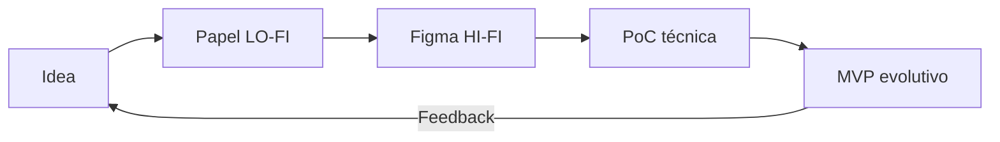
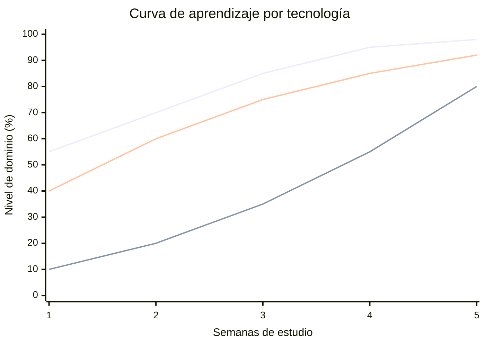

# Sesión 07 — Elección de herramientas

## 2º CFGS DAW/DAM · Proyecto Intermodular II

---
---

## 🗺️ La sesión en un mapa

Cómo elegir las tecnologías **más adecuadas** para implementar el proyecto: decisiones caras de revertir, tomadas con criterio.

<div class="features-grid" style="grid-template-columns:repeat(3,1fr);gap:0.7rem;">
  <div class="feature-item" style="padding:0.5rem 0.6rem;font-size:0.9rem;"><span class="feature-icon" style="font-size:1.4rem;margin-bottom:0.1rem;">🗄️</span><strong>SGBD</strong><br>Relacional vs NoSQL</div>
  <div class="feature-item" style="padding:0.5rem 0.6rem;font-size:0.9rem;"><span class="feature-icon" style="font-size:1.4rem;margin-bottom:0.1rem;">⚖️</span><strong>Licencias</strong><br>MIT · GPL · AGPL · SaaS</div>
  <div class="feature-item" style="padding:0.5rem 0.6rem;font-size:0.9rem;"><span class="feature-icon" style="font-size:1.4rem;margin-bottom:0.1rem;">📐</span><strong>Prototipado</strong><br>LO-FI · HI-FI · MVP</div>
  <div class="feature-item" style="padding:0.5rem 0.6rem;font-size:0.9rem;"><span class="feature-icon" style="font-size:1.4rem;margin-bottom:0.1rem;">📈</span><strong>Curvas</strong><br>Coste de aprender</div>
  <div class="feature-item" style="padding:0.5rem 0.6rem;font-size:0.9rem;"><span class="feature-icon" style="font-size:1.4rem;margin-bottom:0.1rem;">🧮</span><strong>Matriz</strong><br>Decidir con criterios</div>
  <div class="feature-item" style="padding:0.5rem 0.6rem;font-size:0.9rem;"><span class="feature-icon" style="font-size:1.4rem;margin-bottom:0.1rem;">📝</span><strong>ADR</strong><br>Registrar el porqué</div>
</div>

<div class="info">Cuatro decisiones con <strong>coste alto de reversión</strong>: si te equivocas en el SGBD o en una licencia, el cambio puede desmontar media aplicación. Y después los aterrizamos en los <strong>casos típicos de PI por ciclo</strong>: DAM, DAW y ASIR.</div>

---
class: compact-slide
---

## 🧵 TaskFlow: nuestro hilo conductor

<div class="features-grid" style="grid-template-columns:repeat(3,1fr);gap:0.7rem;">
  <div class="feature-item" style="padding:0.6rem 0.7rem;font-size:0.95rem;"><span class="feature-icon" style="font-size:1.5rem;margin-bottom:0.15rem;">📱</span><strong>App móvil (DAM)</strong><br>offline-first, sync en segundo plano</div>
  <div class="feature-item" style="padding:0.6rem 0.7rem;font-size:0.95rem;"><span class="feature-icon" style="font-size:1.5rem;margin-bottom:0.15rem;">🌐</span><strong>API backend (DAW)</strong><br>usuarios, sprints, notificaciones y pagos</div>
  <div class="feature-item" style="padding:0.6rem 0.7rem;font-size:0.95rem;"><span class="feature-icon" style="font-size:1.5rem;margin-bottom:0.15rem;">🛰️</span><strong>Despliegue (ASIR)</strong><br>Docker + Ansible, métricas, <abbr>SSO</abbr></div>
</div>

<div class="info">El proyecto final del material (tipo Trello/Jira). Cada decisión de esta sesión se comprueba una y otra vez contra él: SGBD, licencias, prototipo y curva.</div>

---
class: compact-slide
---

## 🧱 ¿Por qué es tan importante elegir bien?

> Elegir el SGBD o la licencia es como decidir si la casa llevará **electricidad o gas**: si lo decides tarde, no se cambia un enchufe… hay que **abrir las paredes** para pasar tuberías nuevas.

| Si eliges mal… | El coste aparece en… |
| --- | --- |
| **SGBD** | Modelos de datos imposibles, consultas pésimas |
| **Licencia** | Te ves obligado a liberar tu producto (o a reescribir) |
| **Prototipo mal definido** | 3 semanas de diseño que nadie pidió |
| **Curva de aprendizaje** | Calendario en el suelo: 3 semanas de estudio no caben en un sprint |

<div class="warning">A diferencia de un bug (que se arregla en una tarde), las decisiones de herramientas <strong>no se deshacen sin desmontar media aplicación</strong>.</div>

---
---

## 📊 Tipos de SGBD: relacional vs NoSQL

| Tipo | Modelo | Fortaleza | Debilidad | Ejemplos |
| --- | --- | --- | --- | --- |
| **Relacional** | Tablas + FK | ACID, `JOIN`s, muy maduro | Esquema rígido | PostgreSQL, MySQL, SQLite |
| **Documental** | Documentos JSON | Flexibilidad sin esquema | Sin `JOIN`s, consistencia eventual | MongoDB, Firestore |
| **Clave-valor** | Diccionario en memoria | Latencia de microsegundos | Sin relaciones | Redis, Memcached |
| **Grafos** | Nodos + aristas | Conexiones profundas | Ecosistema menor | Neo4j |

<div class="info">No hay «mejor SGBD»: hay <strong>el adecuado para tu modelo de datos</strong>. Para casi todo lo que haréis en PIM2, la respuesta razonable es relacional.</div>

---
class: compact-slide
---

## 🗺️ TaskFlow y el ecosistema SGBD

<div class="diagram-frame">
  <Excalidraw drawFilePath="/diagrams/sesion07-pim-sgbd-tipos.excalidraw" class="diagram-svg" :darkMode="false" :background="false" />
</div>

---
class: compact-slide
---

## 🏭 Taller (relacional) vs almacén (NoSQL)

> **Analogía 🏭📦:** el taller de precisión (relacional) deja cada pieza atornillada en su sitio; el almacén logístico (NoSQL) guarda palés de cualquier forma: mete y saca rapidísimo, pero no le importan las relaciones entre cajas.

| | 🏭 Relacional (taller) | 📦 NoSQL (almacén) |
| --- | --- | --- |
| **Esquema** | Fijo y estricto: toda pieza en su sitio | Flexible: cada documento es una isla |
| **Relaciones** | Atornilladas con FK e integridad | Denormalizadas: duplican datos |
| **Velocidad** | Transacciones y consultas complejas | Lecturas/escrituras masivas y simples |
| **Ideal para** | Usuarios ↔ tareas, cobros, informes | Catálogos, logs, eventos, sesiones |

```sql
-- La misma pregunta en relacional: cuenta por categoría
SELECT c.nombre, COUNT(p.id)
FROM productos p JOIN categorias c ON c.id = p.categoria_id
GROUP BY c.nombre;
```

<div class="info">En NoSQL, si la categoría está <strong>incrustada</strong> en el producto, cambiarla actualiza <strong>cada documento</strong> uno a uno. Ese es el precio de la flexibilidad.</div>

---
class: compact-slide
---

## 🗄️ Cómo elegir el SGBD de TaskFlow

**Regla práctica: el 90&nbsp;% de los proyectos empieza y acaba bien en PostgreSQL.**

<div class="step">
  <div class="step-number">1</div>
  <div class="step-content">¿Entidades con <strong>relaciones estables</strong> (usuarios ↔ proyectos ↔ tareas)? → <strong>Relacional (PostgreSQL)</strong>.</div>
</div>
<div class="step">
  <div class="step-number">2</div>
  <div class="step-content">¿Cuello de botella de lectura (1000 req/s en la portada)? → Añade una <strong>capa de caché (Redis)</strong> delante; no cambies de SGBD.</div>
</div>
<div class="step">
  <div class="step-number">3</div>
  <div class="step-content">¿Problema <strong>nativo</strong> de grafos, series temporales o documentos sueltos? → Entonces sí, evalúa ese NoSQL concreto.</div>
</div>

<div class="warning">Antes de elegir «lo más moderno», preguntad: ¿existe <strong>experiencia en el equipo</strong>, hosting disponible en el aula y comunidad activa? El SGBD más exótico abarata poco y retrasa mucho.</div>

---
class: compact-slide
---

## 🧭 Árbol de decisión del SGBD

<div class="diagram-frame">
  <Excalidraw drawFilePath="/diagrams/sesion07-pim-sgbd-decision.excalidraw" class="diagram-svg" :darkMode="false" :background="false" />
</div>

---
class: compact-slide
---

## ⚖️ Tipos de licencias

| Familia | Filosofía | Riesgo | Ejemplos |
| --- | --- | --- | --- |
| **Permisiva** | «Haz lo que quieras, cita al autor» | Mínimo | MIT, Apache-2.0, BSD-3 |
| **Copyleft débil (LGPL)** | La librería sigue libre; enlazar **dinámicamente** no contamina tu app | Bajo/Medio | LGPL-3.0 |
| **Copyleft fuerte (GPL)** | Si distribuyes el binario, <strong>tu producto entero</strong> debe ser GPL (viral) | Alto | GPL-3.0 |
| **Copyleft de red (AGPL)** | GPL + «si se usa <strong>por red</strong>», también aplica: mata el truco SaaS | Muy alto en SaaS | AGPL-3.0 |
| **Comercial / SaaS** | No compras el código, pagas por el uso | *Vendor lock-in*, costes variables | Licencias de API |

<div class="info">MIT/Apache-2.0 dominan el ecosistema JavaScript (React, Vue, Tailwind). La pregunta clave antes de cada dependencia: <strong>¿es compatible con cómo repartiré mi producto?</strong></div>

---
---

## 📜 Licencias: qué me deja hacer cada una

<div class="diagram-frame">
  <Excalidraw drawFilePath="/diagrams/sesion07-pim-licencias.excalidraw" class="diagram-svg" :darkMode="false" :background="false" />
</div>

---
---

## ⚠️ La trampa del copyleft

Imagina que vuestro app Android usa una librería de hashing con licencia **GPL-3.0**:

<div class="step">
  <div class="step-number">1</div>
  <div class="step-content">GPL-3.0 exige que <strong>quien recibe el binario (el APK)</strong> reciba también el <strong>código fuente entero</strong> de todo bajo GPL… incluida vuestra app.</div>
</div>
<div class="step">
  <div class="step-number">2</div>
  <div class="step-content">Si tu modelo de negocio no quiere publicar el código, <strong>tienes un problema</strong>: la licencia contamina el producto final.</div>
</div>
<div class="step">
  <div class="step-number">3</div>
  <div class="step-content">Soluciones: cambia a una librería <strong>MIT/Apache</strong>, o encapsula la GPL en un <strong>servicio separado</strong> (comunicación por HTTP), si la licencia lo permite.</div>
</div>

<div class="warning">Y el caso peor: sin licencia (<code>Unlicensed</code>) el código NO es libre — todos los derechos reservados. <strong>No lo uses. Nunca.</strong></div>

---
class: compact-slide
---

## 📐 Prototipado: definir antes de construir

Un prototipo es una versión **rápida y barata** de la idea, hecha para **aprender** antes de invertir.

| Nivel | Qué es | Herramienta | ¿Cuándo parar? |
| --- | --- | --- | --- |
| **LO-FI (wireframe)** | Bocetos de baja fidelidad | Papel, Excalidraw, Balsamiq | Cuando el **flujo** está claro |
| **HI-FI (interactivo)** | Maqueta clicable casi final | Figma | Cuando el **diseño** convence |
| **PoC (prueba de concepto)** | Código mínimo que demuestra viabilidad | Proyecto aparte | Cuando se supera el «¿podemos?» |
| **<abbr>MVP</abbr>** | Producto real y desplegado con riesgos integrados | El stack real | Cuando hay **usuarios reales** |

<div class="info">El arquitecto no te enseña el edificio a precio de hormigón: te enseña la <strong>maqueta de cartón</strong>. El prototipo es la maqueta del software.</div>

---
class: compact-slide
---

## ♻️ Prototipo desechable vs. evolutivo

<div class="comparison-grid">
  <div class="comparison-item"><strong>🗑️ Desechable (throwaway)</strong><br><br>Su misión es <strong>aprender y tirarse</strong>. El código es «sucio» a propósito: eso lo hace rápido.<br><br><em>Regla para PIM2:</em> los prototipos de Figma y las PoC son <strong>desechables</strong>.</div>
  <div class="comparison-item"><strong>🔄 Evolutivo</strong><br><br>Se construye con el <strong>stack real</strong> y con calidad, porque va a <strong>crecer hasta ser el producto</strong>.<br><br><em>Regla para PIM2:</em> vuestro <abbr>MVP</abbr> es la versión evolutiva del prototipo… ahora con tests y arquitectura.</div>
</div>



<div class="warning">Error clásico: disfrazar el prototipo de producto final y entregarlo con deuda incrustada. Si es un prototipo de papel y Figma, <strong>no lo reutilices como código</strong>.</div>

---
---

## 🪜 De LO-FI a MVP: TaskFlow, fase a fase

<div class="diagram-frame">
  <Excalidraw drawFilePath="/diagrams/sesion07-pim-prototipado.excalidraw" class="diagram-svg" :darkMode="false" :background="false" />
</div>

---
---

## 📈 Curvas de aprendizaje

La curva modela cómo crece el **dominio** (eje Y) con el **tiempo invertido** (eje X). Su forma **importa** cuando hay un calendario fijo.



<div class="info">La curva «suave» te hace <strong>productivo el primer día</strong>; la «de pared» (Rust, Kubernetes) es frustrante al principio pero alcanza un techo mucho más alto a largo plazo.</div>

---
class: compact-slide
---

## 📉 Las tres curvas, en un vistazo

<div class="diagram-frame">
  <Excalidraw drawFilePath="/diagrams/sesion07-pim-curvas.excalidraw" class="diagram-svg" :darkMode="false" :background="false" />
</div>

---
class: compact-slide
---

## 🚲 Camión vs. bicicleta: cómo influye en la elección

<div class="comparison-grid">
  <div class="comparison-item"><strong>🚛 Framework completo (Laravel, Spring)</strong><br><br>Como aprender a llevar un <strong>camión</strong>: empiezas perdido (ORM, rutas, migraciones) pero transportas lo que sea.<br><br>Cuando encaja: proyectos de 4-6 meses con <strong>tutoría</strong> y comunidad.</div>
  <div class="comparison-item"><strong>🚲 Framework micro (Express, Flask)</strong><br><br>Como una <strong>bicicleta</strong>: en 10 minutos ya te mueves.<br><br>El problema: cuando el proyecto crece, tendrás que improvisar el «camión» tú mismo… <strong>y mal</strong>.</div>
</div>

| Curva | Cuándo elegirla | Cuándo evitarla |
| --- | --- | --- |
| **Suave** | Plazos cortos, prototipos, equipo junior | Sistemas de altísima concurrencia |
| **Pared** | Proyectos de larga vida, requisitos extremos | Plazos de 3 meses (¡como PIM2!) |
| **S (framework)** | 4-6 meses con tutoría | «Tengo 2 semanas» (valle = muerte) |

<div class="info">La curva de aprendizaje <strong>no la paga el proyecto: la paga vuestro calendario</strong>. Elegir lo que el equipo ya domina —aunque no sea lo más moderno— es una decisión redonda.</div>

---
class: compact-slide
---

## 📱 Casos de PI: DAM (app nativa)

### App Android que gestiona algo concreto, a menudo offline-first.

| Caso | SGBD | Stack típico | Curva |
| --- | --- | --- | --- |
| **Inventario de pequeño comercio** | SQLite embebida | Kotlin + Compose + Room | Suave |
| **App de citas/turnos** (clínica, taller) | PostgreSQL + SQLite local | Compose + REST (Laravel/FastAPI) | Media |
| **Gestor de la FCT** (horas, tareas) | PostgreSQL | Compose + REST + JWT | Media |

<div class="info">Licencias: Android y Compose son Apache/MIT sin drama; lo que vigila son los SDK <strong>propietarios</strong> (Firebase, Play Billing, mapas o pagos). <strong>Prototipo</strong>: Figma de pantallas (desechable) → <abbr>MVP</abbr> evolutivo con Compose + Room. <strong>¿Y TaskFlow?</strong> Es el caso «citas/turnos»: app offline-first que sincroniza contra su API.</div>

---
class: compact-slide
---

## 🌐 Casos de PI: DAW (plataforma web)

### Portal web con roles y panel administrativo: PostgreSQL casi siempre.

| Caso | SGBD | Stack típico | Curva |
| --- | --- | --- | --- |
| **Reservas online** (pistas, citas) | PostgreSQL + Redis (caché) | Laravel o Express + Vue/React | Media |
| **Gestión de club deportivo** (socios, cuotas) | PostgreSQL | Laravel + Blade/Vue | Media |
| **Tienda / catálogo con panel admin** | PostgreSQL (o MongoDB si muta a diario) | Vue/React + Express/Laravel | Suave/Media |
| **Portal de incidencias** (tickets) | PostgreSQL | Laravel/Vue + notificaciones | Media |

<div class="warning">Licencias: el stack web es MIT/Apache sin drama; el riesgo entra por <strong>librerías auxiliares</strong> (PDFs: iText AGPL, OpenPDF/​dompdf LGPL) o por <strong>plantillas comerciales</strong> (una licencia = un proyecto final). <strong>Prototipo</strong>: Figma desechable + PoC de pagos aparte; <abbr>MVP</abbr> evolutivo con el stack real.</div>

---
class: compact-slide
---

## 🛰️ Casos de PI: ASIR (servicios en red)

### Desplegar y documentar un servicio completo. El SGBD lo elige el servicio, no tú.

| Caso | SGBD del servicio | Stack típico | Curva |
| --- | --- | --- | --- |
| **Nextcloud + Office online** | PostgreSQL (oficial) | Docker + Nginx + Ansible | Media |
| **Monitorización de red** | Prometheus + Grafana (SQLite interno) | Prometheus + Grafana + alertas | Media |
| **SSO corporativo** (Keycloak + LDAP) | PostgreSQL | Keycloak + Ansible | Media |
| **VPN + firewall** (pfSense/WireGuard) | No aplica (SQLite interno) | pfSense + reglas + backups | Suave |

<div class="warning">Licencias por <strong>servicio</strong>: Nextcloud y Grafana son <strong>AGPL</strong> (desplegar sin tocar su código → sin problema; modificar y ofrecer por red → publicar cambios). Keycloak Apache-2.0, pfSense BSD, Ansible GPL (tus playbooks YAML son datos). <strong>Prototipo</strong>: lab con snapshot (desechable) → infra con IaC documentada (evolutiva). <strong>Kubernetes es «pared»: evitarlo en PI.</strong></div>

---
class: compact-slide
---

## 🛠️ Herramientas de desarrollo: el entorno

| Área | Opciones típicas | Licencia / coste | En PIM2 |
| --- | --- | --- | --- |
| **Editor / IDE** | VS Code · IntelliJ/Android Studio | VS Code: MIT (núcleo) · AS/IntelliJ CE: Apache-2.0 | Android Studio en DAM; VS Code en web |
| **Control de versiones** | Git + GitHub/GitLab | Git GPL · hosting SaaS (plan gratuito, pack de estududiante) | obligatorio: sin repo, no hay PI |
| **Terminal / entorno** | Linux · WSL2 | libres | para ASIR es parte del servicio |
| **Gestión del proyecto** | Trello · GitHub Projects | freemium | puede <strong>ser el propio producto</strong> (TaskFlow) |

<div class="info">Se decide <strong>ya</strong> y se registra en otro ADR: los atajos, plugins y la IA se ajustan a ti. Y ojo: <strong>gratis ≠ libre</strong> — el Marketplace y el hosting te traen condiciones propias.</div>

---
class: compact-slide
---

## 🤖 Agentes de IA: quién es quién

| Agente | Qué es | Licencia / coste | Encaja si… |
| --- | --- | --- | --- |
| **opencode** | Agente CLI/TUI open source | OSS (MIT) · modelo <em>BYOK</em> | privacidad, hasta modelos locales |
| **Codex (OpenAI)** | Agente en ChatGPT + CLI | herramienta libre · servicio por suscripción | ya usas ChatGPT |
| **Claude Code (Anthropic)** | Agente en terminal/IDE, MCP | propietaria · Claude Pro/Max o API | flujo agéntico potente |
| **Antigravity (Google)** | IDE agéntico (sobre VS Code) | gratuito (preview), Gemini integrado | probar el flujo completo sin pagar |
| **Freebuff** | Agente gratuito en el chat del proyecto | gratuito, con modelo | empezar sin instalar nada |

<div class="warning">Elegir agente = decisión de herramienta: <strong>privacidad</strong> (¿sale tu código del equipo?), <strong>cuota</strong> y <strong>trazabilidad</strong> (commits y PR revisables; nada de secretos en los prompts). La IA ayuda a escribir el código; <strong>el ADR sigue siendo tuyo</strong>.</div>

---
class: compact-slide
---

## 🧮 La matriz de decisión

Ejemplo real: el SGBD de **TaskFlow**. Convertir la intuición en **criterios explícitos con pesos**, y documentar el resultado en la memoria del proyecto. Funciona igual con un PI de DAM (la app), de DAW (la web) o de ASIR (el despliegue): lo que cambia es la lista de candidatos y los pesos.

```text
CRITERIO (peso)             PostgreSQL   MongoDB   SQLite
─────────────────────────────────────────────────────────
Encaje con el modelo (x4)      5            3        4
Coste de aprendizaje (x3)      4            3        5
Ecosistema/comunidad (x2)      5            4        3
Licencia compatible  (x3)      4            4        5
Herramientas del aula (x1)     5            3        5
─────────────────────────────────────────────────────────
TOTAL PONDERADO               47           31       45
```

<div class="step">
  <div class="step-number">1</div>
  <div class="step-content">Lista los candidatos (mínimo 2-3 alternativas razonables).</div>
</div>
<div class="step">
  <div class="step-number">2</div>
  <div class="step-content">Puntúa del 1-5 cada criterio y <strong>pondera</strong> según la importancia para el proyecto.</div>
</div>
<div class="step">
  <div class="step-number">3</div>
  <div class="step-content">Documenta el porqué como <strong>ADR</strong> (mini-ficha de decisión) en la memoria: contexto → decisión → consecuencias.</div>
</div>

---
class: compact-slide
---

## ✅ Resumen de la sesión

- El SGBD se elige por el **modelo de datos**: relacional para TaskFlow, caché (Redis) si hay cuello de botella, NoSQL solo si tu problema es nativo documental/gráfico/columnar.
- Las licencias: **MIT/Apache sin drama**; GPL/AGPL «contaminan» el producto si lo distribuyes; **sin licencia = inutilizable**.
- El prototipo valida la idea barato y rápido (**LO-FI/HI-FI desechable**); el <abbr>MVP</abbr> con el stack real es <strong>evolutivo</strong>.
- Las curvas de aprendizaje condicionan el calendario: no eliges la tecnología más potente, eliges **la que el equipo domina a tiempo**.
- El <strong>entorno</strong> y los <strong>agentes de IA</strong> son herramientas más: licencia, cuota y <strong>privacidad del código</strong> (gratis ≠ libre).
- Toda elección se pasa por la <strong>matriz de decisión</strong> y se registra en la memoria como <strong>ADR</strong>.

<div class="info">El coste de elegir mal no es el tiempo perdido: es que las decisiones de herramientas <strong>no se deshacen sin desmontar media aplicación</strong>.</div>

---
layout: closing
---
