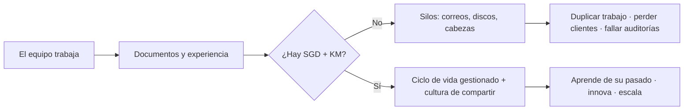
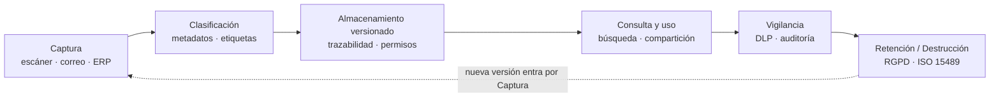
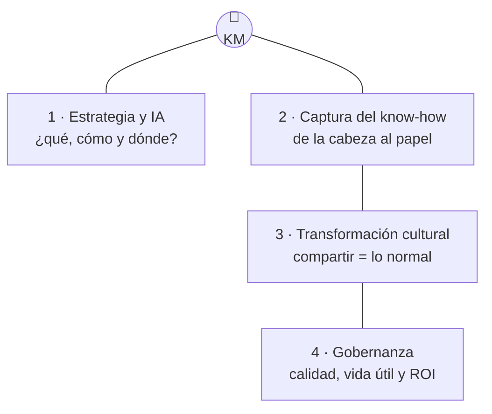

> [!TIP] Analogía de arranque: la biblioteca y el bibliotecario
> Piensa en una biblioteca sin catálogo ni estanterías (un almacén de cajas sueltas) y sin bibliotecario (nadie que sepa dónde está nada). El **SGD** son las estanterías, el catálogo y las normas de préstamo; el **Knowledge Manager** es el bibliotecario: sabe qué tiene valor, enseña a buscar y se asegura de que la gente devuelve lo prestado. Una organización solo funciona bien cuando tiene ambos.

# SGC + Knowledge Manager = Conocimiento que genera valor

**Tecnología y estrategia, un tándem clave para gestionar, aprovechar y compartir el conocimiento.**

Esta sesión responde a una pregunta molesta: *¿por qué las organizaciones que invierten mucho en software siguen perdiendo información y repitiendo errores?* La respuesta casi nunca es la herramienta: es la falta de la otra mitad.

## 1. El problema: la información existe, el conocimiento no circula

Cualquier empresa ya «tiene» la información: está en correos, carpetas `Comunes`, discos externos y chats. El problema no es *tenerla*, es que:

*   nadie puede **encontrarla** cuando hace falta (los humanos buscamos a mano),
*   nadie sabe **qué versión** es la buena (`final_v2_bueno_OK-ahora-si.docx`),
*   y lo que sabe el equipo **vive en cabezas** que pueden irse de vacaciones… o de la empresa.



> [!TIP] Batallita: la prueba de la factura
> En una PyME con 12 personas les pedí **la factura del proveedor de diciembre del año pasado**. Opciones reales: (A) 10 s buscándola, (B) 2 min navegando a la carpeta del proyecto, (C) email a contabilidad y esperar, (D) «estaba escaneada en un CD del despacho de Mercedes… que se jubiló». Si tu organización responde C o D, ya tienes el material de esta sesión.

## 2. SGD: la infraestructura tecnológica y normativa

El **Sistema de Gestión Documental** (SGD, también EDMS/ECM) es la infraestructura tecnológica y normativa para gestionar el **ciclo de vida de la información**: desde que un documento entra (escáner, correo, ERP) hasta que se destruye (o se retiene) según la ley.



Las cinco funciones clave:

| # | Función | Qué garantiza |
| :-- | :--- | :--- |
| 1 | **Captura e ingesta** | Todo entra por el mismo canal (escáner, correo, ERPs, CRMs), nada por las bandas. |
| 2 | **Metadatos y clasificación** | Encontrar cualquier documento en segundos (autor, fecha, tipo, proyecto). |
| 3 | **Control de versiones y trazabilidad** | Quién cambió qué, cuándo y por qué: el historial nunca se pierde. |
| 4 | **Preservación y retención** | Qué se archiva, cuánto se conserva y cuándo se destruye (RGPD, ISO 15489). |
| 5 | **Seguridad** | Cifrado, permisos granulares, DLP: quién ve, edita, exporta o borra. |

::: details Batallita: el vertedero «Comunes»
En una PyME de 12 personas, el servidor compartido acabó en una sola carpeta `Comunes`: **40 GB sin estructura** y documentos tipo `presupuesto-FINAL_v3_bueno_ahora-si.docx`. Nadie sabía qué era lo vigente; se había pagado dos veces el mismo trabajo porque dos equipos lo prepararon en paralelo sin saberlo.

Lecciones:

1.  El vertedero no se limpia: **se coloniza** (se migra solo lo vivo, con fecha < 2 años; el resto se congela y se archiva).
2.  Se arregla con **reglas y un sprint pequeño** (Nextcloud + carpeta por proyecto + nomenclatura), no con heroísmo de tres semanas.
3.  El coste real no fue el desorden: fue el **trabajo duplicado**.
:::

::: details Batallita: la auditoría y el portátil del cajón
Llegó la auditoría de facturas, contratos y actas, y apareció una factura de **2012** en el escritorio de un portátil que estaba **en un cajón**: «así nadie la borra». La prudencia era real, pero la técnica era grave: un documento sin índice, sin copia y sin dueño no es un archivo, es una **anécdota** hasta que falla.

Lecciones:

1.  La seguridad por **ocultación** es la más cara: no se audita, no se respalda, no se transfiere.
2.  Las normativas (RGPD, ISO 15489) no llegaron a castigar: llegaron a **orientar la supervivencia** del negocio.
3.  Tras ese día, el SGD pasó de «deseable» a «sí o sí».
:::

## 3. Knowledge Manager: la visión estratégica, cultural y metodológica

El **Knowledge Manager (KM)** no es una herramienta ni un programa: es un **rol humano** con cuatro funciones concretas.



| # | Función | De qué se encarga |
| :-- | :--- | :--- |
| 1 | **Estrategia y Arquitectura de la Información** | Diseña **qué** conocimiento se captura, **cómo** se organiza y **dónde** vive (taxonomías, plantillas, cadena de custodia). |
| 2 | **Captura y Conversión del Conocimiento** | Saca el **know-how** de la cabeza de los veteranos y lo convierte en base de conocimiento (guías, wiki, plantillas, post-mortems). |
| 3 | **Transformación Cultural y Adopción** | Cambia el hábito: compartir y colaborar pasa a ser **lo normal** (mentores, parejas de aprendizaje, formación). |
| 4 | **Gobernanza y Mantenimiento** | Mide la **calidad**, la **vida útil** y el **ROI** de lo escrito; retira lo caducado antes de que engañe a nadie. |

::: details Batallita: el campeón silencioso
Un departamento técnico tenía una wiki de hace 3 años, pero el conocimiento real lo sostenía **una persona** («la que siempre está»). Cuando esa persona cogió vacaciones largas, el equipo descubrió quién era el campeón silencioso: la wiki llevaba **un año sin tocarse**.

Lo arreglaron con un protocolo de captura: cada vez que alguien preguntaba a la experta, **la respuesta la escribía el preguntador en la wiki**. Y el KM se encargó de que se usara. Lecciones:

1.  El **tácito** no se archiva con copiar-pegar: se captura en el momento en que circula.
2.  El KM es la persona que **diseña el hábito** — «lo que aprendimos, a la wiki».
3.  En tu proyecto de aula: **documenta mientras aprendes**, no después.
:::

::: details Batallita: la wiki fantasma
En un departamento de marketing instalaron una wiki «de dirección» con 90 páginas llenas de texto. Un año después, la página más visitada tenía 41 visitas y la mayoría, cero. No era un problema de herramienta: nadie sabía **qué buscar ni dónde empezar**.

La solución fue más incómoda que técnica: borrar la mitad de las páginas (se conservaron 12 vivas), empezar **3 páginas semilla** (guía de arranque, decisiones tomadas, glosario) y adoptar el hábito *pregunta → respuesta → wiki* en cada reunión. Dos meses después: 6 usuarios activos semanales y 30 búsquedas resueltas.

Lecciones:

1.  La wiki no se promociona, **se siembra**: 12 páginas vivas valen más que 90 esqueletos.
2.  El indicador de salud no es el número de páginas: es las **búsquedas resueltas por semana**.
3.  El hábito *pregunta → respuesta → wiki* es lo que convierte una wiki en viva.
:::

## 4. La tabla de sinergia: dos mitades de algo grande

| Dimensión | Sistema de Gestión Documental (SGD) | Knowledge Manager (KM) |
| :--- | :--- | :--- |
| **Naturaleza** | Herramienta tecnológica / Proceso estructurado | Rol humano / Estratégico y cultural |
| **Foco principal** | Conocimiento explícito (archivos, facturas, actas, contratos) | Conocimiento tácito + explícito (experiencia, buenas prácticas) |
| **Objetivo** | Control, seguridad, trazabilidad y recuperabilidad | Transferencia de aprendizaje, innovación y eficiencia operativa |
| **Pregunta clave** | ¿Dónde está el documento y quién tiene permiso para verlo? | ¿Qué aprendizaje obtuvimos y cómo evitamos reinventar la rueda? |

> [!TIP] Analogía: el almacén y el encargado de compras
> El SGD es el **almacén** (estanterías, cajas rotuladas, registro de entradas/salidas). El KM es el **encargado** que sabe qué merece la pena comprar, qué caduca, qué se comparte entre semana. Un almacén sin encargado llena la caja; un encargado sin almacén es una lista de preguntas que nadie puede atender. Para inventario de valor, se necesitan los dos.

::: warning La lección del impacto de la ausencia
*   **Sin un SGD**: el KM carece de la **plataforma centralizada** donde consolidar la información: el conocimiento tácito queda disperso en correo, chats y cabezas.
*   **Sin un KM**: el SGD degenera en **vertedero digital** de archivos desordenados y poco usados; nadie encuentra nada y la experiencia de los equipos no se comparte.
:::

## 5. Software recomendado (casi todo libre, casi todo en Docker)

::: tip ¿Primera elección rápida?
*   **Papel → PDF buscable**, PYME con caos de papel: **Paperless-ngx**.
*   **Colaboración + control**: **Nextcloud** (archivos, versiones, calendario) + **DokuWiki** (wiki ligera sin BD).
*   **Equipo pequeño que vive de notas**: **Obsidian** (gratis, propietaria, local) — el conocimiento individual.
*   **Organización con requisitos legales**: **Mayan EDMS** (Apache-2.0) o **OpenKM**.
:::

SGD/EDMS (la parte tecnológica):

| Herramienta | Qué es | Licencia | Cuándo elegirlo |
| :--- | :--- | :--- | :--- |
| **Paperless-ngx** | Digitaliza, etiqueta (OCR) y archiva: «todo papel → PDF buscable» | GPL-3.0 | El punto de partida ideal en PYME y en clase (Docker sencillo). |
| **Mayan EDMS** | EDMS completo: workflows, versiones, permisos por grupo, custodia | Apache-2.0 | Cuando quieres procesos documentales formales. |
| **OpenKM** | EDMS clásico con expedientes y firmas | GPL / comercial | Despachos y organismos con requisitos de expediente. |
| **Nextcloud** | La nube de casa: archivos, versiones, Calendar, Text | AGPL-3.0 | El escalón de entrada en cualquier aula o PYME. |
| **SharePoint** | El EDMS corporativo de facto (Microsoft 365) | comercial | Cuando ya vives dentro del ecosistema M365 y Teams. |

KM (la parte humana, con soporte tecnológico):

| Herramienta | Qué es | Licencia | Cuándo elegirlo |
| :--- | :--- | :--- | :--- |
| **MediaWiki** | El motor de Wikipedia, probado a escala planetaria | GPL-2.0+ | Base de conocimiento colectiva, grande y navegable. |
| **DokuWiki** | Wiki ligera sin base de datos, fácil de respaldar | GPL-2.0 | Equipos pequeños y servidores humildes (o escolares). |
| **XWiki** | Wiki «empresarial» con aplicaciones, flujos y macros | LGPL-2.1 | Cuando la wiki necesita procesos y permisos por equipo. |
| **Obsidian** | Bóveda local de notas con enlaces y grafo | propietaria (personal gratis) | El conocimiento individual; la sincronía de equipo es de pago. |
| **Notion** | Todo-en-uno SaaS (wiki + bases de datos + tareas) | freemium | Equipos que prefieren interfaces cuidadas a auto-organización. |
| **Discourse** | Foro moderno con reputación y etiquetas | GPL-2.0 | Cuando el conocimiento viene de *conversaciones* (soporte, comunidad). |

> [!WARNING] Ojo con el «gratis» de los SaaS
> Obsidian es propietaria (pero tus notas son ficheros Markdown cómodamente tuyos). Notion es freemium: tu conocimiento vive en su nube… a cambio de que te fíes de sus términos. Con las wiki y EDMS de licencia libre, **tu contenido vive en tu servidor** — y eso, para una PyME, es una garantía de supervivencia.

## 6. Trucos de oro (aprendidos en el campo)

1.  **Nomenclatura `AAAA-MM-DD_proyecto_asunto`**: el nombre ordena por fecha y tema sin disciplina ninguna; es el hack más rentable.
2.  **Un documento, un dueño**: quien lo cambia deja rastro; si nadie lo reclama, es un huérfano y se va al cementerio.
3.  **Taxonomía ≤ 10 ramas**: la clasificación de 40 categorías nunca se mantiene; 10 sí.
4.  **Regla de los 2 minutos**: si archivarlo cuesta menos de 2 min, se archiva **ahora** (no inbox del viernes).
5.  **Busca antes de crear**: «¿ya lo escribimos?» es la pregunta más rentable del equipo.
6.  **Revisión trimestral**: lo no tocado en 6 meses, con etiqueta de caducidad visible.
7.  **La wiki gana su vida**: se mide en *búsquedas resueltas por semana* — si esto crece, la adopción crece.
8.  **IA para lo aburrido (2026)**: etiquetar y resumir en masa está bien resuelto; para **decidir** qué se conserva (y qué no) siempre tiene que haber una persona.
9.  **El chat no es un archivo**: lo importante del chat se mueve pendiente → wiki/SGD con enlace cruzado.
10. **Empieza pequeño y a ritmo semanal**: una carpeta por proyecto + nomenclatura + wiki con una página por proyecto renta más que un gran proyecto de conocimiento inaugurado y muerto.

::: details Truco para el aula: tu PI como mini-SGC
Aplica el tándem a tu proyecto de ciclo: **Nextcloud** como SGD casero (dossier, capturas, facturas del proyecto… con estructura `AAAA-MM-DD_proyecto_…`), **DokuWiki/MediaWiki** como KM (decisiones, errores y soluciones, glosario), y **una revisión trimestral en el calendario**. Entregable visible desde la semana 1, y encima ensayas las dos caras del tándem.
:::

## 7. Checklist final

*   ¿Es conocimiento **explícito**? → SGD. ¿Es **tácito**? → KM (y lo ideal es el tándem).
*   ¿Hay **normativa** que obligue (RGPD, ISO 15489, auditoría)? → el EDMS es *sí o sí*.
*   ¿Qué **tamaño**? persona → Obsidian; equipo → Nextcloud + wiki; organización → EDMS completo.
*   ¿Puedes **mantenerlo** (Docker, una BD, backups)? Si no, «potente» no basta.
*   ¿Qué **licencia**? Libre (GPL/MIT/Apache) para el PI; cuidado con lo propietario y el SaaS.
*   ¿Quién es el **campeón**? Sin una persona responsable de revisión y adopción, en 6 meses la herramienta muere.

## 8. La chuleta legal: plazos de retención y marcos de referencia

La retención no es una opinión: es un plazo legal. La chuleta que se pega al lado del escáner:

| Tipo de documento | Marco | Plazo típico |
| :--- | :--- | :--- |
| Contables (facturas, libros) | Código de Comercio (art. 30) / LGT | 6 años / 4 años fiscales |
| Laborales (contratos, nóminas, sanciones) | Estatuto de los Trabajadores | 4 años |
| Protección de datos (consentimientos, bajas) | RGPD + LO 3/2018 | Mientras exista la relación + prescripción (3-5 años civiles) |
| Comunicaciones y cookies (web) | LSSI (Ley 34/2002) | 12 meses desde la desconexión |
| Actas y acuerdos de dirección | Documento vital del proyecto | Mientras exista la organización/proyecto |

Marcos de referencia para el diseño del SGD:

*   **ISO 15489** — cómo se gestionan y describen los documentos (metadatos, custodia, ciclo de vida).
*   **MoReq2010** — requisitos europeos funcionales para un EDMS (la lista de comprobación al comprar o desplegar).
*   **RGPD + LO 3/2018 (LOPDGDD)** — qué datos personales se conservan, por cuánto tiempo y con qué garantías.
*   **eIDAS** — la firma electrónica que da valor legal a los documentos gestionados.

> [!TIP] RGPD en una frase
> Retén **solo lo necesario, solo el tiempo necesario, solo con la seguridad necesaria** (arts. 5.1.c y 5.1.e). Y cuando el plazo expire, **borra de verdad**: no un «mover a backup depósito» indefinido.

## 9. Plantilla de decisión (mini-ADR de herramientas)

Cada elección de herramienta se registra: qué contexto, qué opciones, qué criterios, por qué se eligió esa y cuándo se revisa. En el proyecto de aula y en la empresa, un ADR por decisión:

```text
ADR-<número>: selección de <tipo de herramienta> para <proyecto>

Fecha:      AAAA-MM-DD
Estado:     propuesta | aceptada | revisada AAAA-MM-DD
Decisor:    <rol de quien decide>

Contexto
    ¿Qué problema queremos resolver? (1-3 frases)
    ¿Qué documentos o conocimiento hay que gestionar?

Opciones consideradas
    1. <Herramienta A> — <licencia> — <hospedaje>
    2. <Herramienta B> — <licencia> — <hospedaje>

Criterios
    Legales (RGPD / ISO 15489) · Mantenimiento · Licencia
    Curva de aprendizaje · Coste · Integración con lo existente

Decisión
    <Herramienta elegida, con su versión>

Motivación
    ¿Por qué esta y no las otras? (2-4 frases honestas)

Consecuencias
    ¿Qué mejora? ¿Qué riesgo asumimos? ¿Cuándo se revisa? (fecha concreta)
```

> [!TIP] También para el aula
> En tu PI: un ADR por cada decisión de herramienta (SGD, wiki, captura, IA). Es de las pocas prácticas de la industria que se llevan al aula **sin cambiarlas**.

## 10. Actividad de aula: auditoría exprés de tu propia información (60 min)

Objetivo: aplicar el tándem a tu información real y salir con tu primer mini-ADR. Funciona igual de bien con los discos de la empresa y con tu carpeta de clase:

| Minutos | Paso |
| :-- | :--- |
| 0-5 | **Inventario de silos**: ¿cuántos sitios usas para guardar trabajo? (carpetas, chat, notas, disco externo…) |
| 5-20 | **Radiografía del vertedero**: tu carpeta más caótica — ¿cuánto pesa? ¿cuántos `*_FINAL_v2*`? ¿qué tocaste hace más de 2 años? |
| 20-30 | **Vivo vs histórico**: lo usado en 90 días es vivo (migra con nomenclatura); el resto, se congela y se archiva. |
| 30-40 | **Nomenclatura y taxonomía**: acuerda `AAAA-MM-DD_proyecto_tema` y ≤ 10 carpetas base. |
| 40-50 | **Elegir tándem**: aplica el checklist de la sección 7 a tu caso (persona / equipo / organización). |
| 50-60 | **Primer ADR**: registra tu decisión y publícala en la wiki de tu proyecto. |

> [!TIP] Entregable de la actividad
> Cada grupo entrega: (a) el inventario de silos, (b) la nomenclatura acordada, y (c) su **ADR firmado para fecha**… que es, de hecho, el primer acto de KM del grupo.

## 11. Glosario

*   **SGD / EDMS / ECM** — la infraestructura para gestionar el ciclo de vida de la información (también *Electronic Document Management System* / *Enterprise Content Management*).
*   **Knowledge Manager (KM)** — rol humano que diseña la captura y el gobierno del conocimiento; no es una herramienta.
*   **Conocimiento explícito** — el que cabe en un archivo: facturas, actas, manuales, plantillas.
*   **Conocimiento tácito** — el que vive en cabezas: experiencia, trucos de oficio, *know-how*.
*   **Metadatos** — datos sobre los datos: autor, fecha, tipo, proyecto, versión.
*   **OCR** — reconocimiento óptico de caracteres: convierte la imagen de un escaneo en texto buscable.
*   **DLP** — *Data Loss Prevention*: reglas que impiden que un documento confidencial salga de la organización.
*   **Taxonomía** — el árbol de clasificación (carpetas, etiquetas) por el que se ordena la información.
*   **Plazo de retención** — cuánto tiempo se conserva un documento antes de eliminarse o archivarse definitivamente.
*   **ADR** — registro corto de una decisión: contexto, opciones, decisión, consecuencias.
*   **Sprint de migración** — el esfuerzo acotado (días, no meses) para mover lo vivo del vertedero al sistema nuevo, con nomenclatura; el resto se congela y se archiva.
*   **Campeón / champion** — la persona que sostiene la adopción; la más importante de la lista de compras.

## 12. FAQ (las que surgen siempre)

*   **¿Un Google Drive / OneDrive no es ya un SGD?** — Es el escalón colaborativo de entrada, pero le faltan metadatos formales, expedientes, retención y trazabilidad normativa. Para acercarte: Nextcloud + apps; para llegar: Mayan / Paperless-ngx.
*   **¿Puedo empezar solo con una wiki?** — Sí, es el arranque más barato y honesto (wiki + nomenclatura en carpeta compartida). Si aparece normativa o papel físico, el EDMS llega pronto y solo.
*   **¿El KM es un puesto para grandes empresas?** — Empieza siendo un *encargo* de pocas horas a la semana (la dueña, el jefe de proyecto); el año 2 suele justificar dedicación propia cuando ya hay wiki viva.
*   **¿Y si el equipo no la usa?** — Tres palancas: el hábito en el flujo existente (reunión, correo), el beneficio visible (se encuentra por búsqueda), y el campeón. Si en 6 meses no despega: probablemente la herramienta no resuelve un **dolor real** del equipo.
*   **¿La IA no resuelve ya esto?** — Ayuda a clasificar, resumir y buscar; no decide qué merece la pena conservar ni crea la cultura de compartir. Para eso sigue siendo insustituible el tándem humano.

**En resumen:** el SGD da **orden y seguridad**; el KM da **propósito y cultura**. Juntos, multiplican el valor: una organización más eficiente, innovadora y preparada para el futuro.
